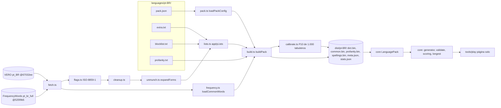

# M1 Dictionary Pack and Game Rules Design

**Spec**: `.specs/features/m1-dictionary-pack/spec.md`
**Status**: Approved - 2026-10-26, junto com as tasks (user: "execute cada fase, pare, me mostre o resultado e me pergunte antes de executar a proxima fase")

> Extraído em 2026-10-27 da seção "Inline design" do `tasks.md` do M1, depois do marco fechado. As decisões são as mesmas que foram aprovadas e implementadas. Os componentes foram conferidos contra o código em `HEAD`, e os riscos vêm do `verification.md` do M1, do `docs/m0-results.md` e do pacote construído. O M1 não registrou abordagens alternativas, então este documento não inventa nenhuma.

---

## Architecture Overview

O build transforma `languages/<id>/` (configuração + listas em texto) e duas fontes fixadas por commit (VERO e FrequencyWords) num pacote binário em `tools/dict-build/dist/<id>/`. O `core` lê esse pacote como `LanguagePack` e roda as regras do jogo sobre ele. A página solo (`tools/play`) carrega o pacote no navegador e roda o `core` ali, para calibrar os tabuleiros.

---

## Code Reuse Analysis

### Existing Components to Leverage

| Component | Location | How to Use |
| --- | --- | --- |
| DAWG v1 do M0 | `packages/core/src/dawg.ts` | Formato de `dict.bin`, `common.bin` e `profanity.bin`, sem mudanças |
| Solver | `packages/core/src/solver.ts` | Base de `boardSolutions`, do gerador e da calibração |
| Gerador do M0 | `packages/core/src/generator.ts` | Passa a receber o pacote e as opções (`minCommonWords`, `filterProfanity`) |
| `SourceSpec` / `fetchSource` | `tools/dict-build/src/fetch.ts` | Download das fontes fixadas por commit |
| Expansão do M0 | `tools/dict-build/src/unmunch.ts`, `flags.ts` | `unmunch` com as flags regravadas em ISO-8859-1 (correção E1 do M0) |

### Integration Points

| System | Integration Method |
| --- | --- |
| `tools/dict-build/source.json` (M0) | Removido; o conteúdo foi para `languages/pt-BR/pack.json` |
| Página solo | Vite serve `tools/dict-build/dist/pt-BR` em `/pack/` e a fixture de E2E em `/e2e-fixture/` (`tools/play/vite.config.ts`) |
| Servidor (M2) | O mesmo `dist/pt-BR/` vira Static Assets do Worker; `LanguagePack.fromBuffers` é o ponto de entrada |

---

## Components

### Pack config

- **Purpose**: Ler e validar `languages/<id>/pack.json`.
- **Location**: `tools/dict-build/src/pack.ts`
- **Interfaces**: `loadPackConfig(dir): Promise<PackConfig>`. Campos: `id`, `name`, `alphabet`, `compoundTiles` (`[{ tile: "Qu", letters: "qu" }]`), `normalization` (`"strip-diacritics"`), `minWordLength`, `sources.vero` (repo, commit, dic, aff) e `sources.frequency` (repo, commit, path, `top: 50000`). Um campo obrigatório ausente encerra com erro que nomeia o campo.

### Word lists

- **Purpose**: Ler `extra.txt` e `blocklist.txt` e aplicá-los.
- **Location**: `tools/dict-build/src/lists.ts`
- **Interfaces**: `readWordList(path)` (uma palavra por linha, `#` comenta), `applyLists({ extra, blocklist })`. O `extra.txt` aceita acento e passa pelos filtros; o `blocklist.txt` remove a forma normalizada exata; uma palavra nas duas listas faz o build falhar.

### VERO cleanup

- **Purpose**: Tirar as entradas `FORBIDDENWORD` e os fragmentos de ênclise/mesóclise que o `unmunch` imprime como palavras ("enfronhamo", "enfronhá").
- **Location**: `tools/dict-build/src/cleanup.ts`
- **Interfaces**: `fragmentRules(affLines)` acha as regras de fragmento (append em "mo" com gêmea em "mos" e sem gêmea feminina "ma"; ou infinitivo genérico ar/er/or → á/ê/ô); `cleanupVero(...)` expande sem essas regras, mantém as formas que outra regra também gera e conta as removidas, com exemplos.
- **Regra decidida no T3**: as regras com condição específica (`SFX e ar á dar`, `SFX h er ê ver`) ficam, porque geram formas reais de verbos irregulares ("dá", "vê", "crê").

### Common words

- **Location**: `tools/dict-build/src/frequency.ts`
- **Interfaces**: `loadCommonWords(...)`: top 50.000 formas da FrequencyWords. Formas que viram a mesma palavra sem acento somam as contagens antes do ranking.

### Build pipeline

- **Location**: `tools/dict-build/src/build.ts`
- **Interfaces**: `buildPack(id, opts)`, `PACK_FILES`. Grava `dist/<id>/` byte a byte reproduzível (exceto os tempos de `stats.json`) e põe o SHA-256 de cada binário no `meta.json`.

### Calibration

- **Location**: `tools/dict-build/src/calibrate.ts`
- **Interfaces**: `calibrate(pack)`: sorteia 1.000 tabuleiros por tamanho (semente 20261026) e grava em `meta.minCommonWords` o percentil 10 das palavras comuns, pelo método nearest-rank.

### Display spellings

- **Location**: `packages/core/src/spellings.ts`
- **Interfaces**: `buildSpellings(entries)`, `Spellings.fromBuffer(buf)`, `get(word)`.

### Language pack

- **Location**: `packages/core/src/pack.ts`
- **Interfaces**: `LanguagePack.fromBuffers({ dict, common, profanity, spellings, meta })`, com `isWord`, `isCommon`, `isProfane`, `spellings(word)` e `meta`.

### Game rules

| Module | Interfaces |
| --- | --- |
| `packages/core/src/validate.ts` | `boardSolutions(board, pack, { minLength, filterProfanity })`, `validateSubmission(board, path, ctx)` com os motivos `invalid-path`, `too-short`, `not-a-word`, `already-found` |
| `packages/core/src/scoring.ts` | `wordPoints(word)` (letras − 2; "Qu" conta 2), `scoreRound(found)` → totais, únicas e em comum |
| `packages/core/src/longest.ts` | `pickLongestWord(solutions, pack, found, filterProfanity)`: maior palavra comum; desempate para uma achada e depois a primeira em ordem alfabética |
| `packages/core/src/generator.ts` | `generateBoard(size, seed, pack, { filterProfanity, minCommonWords })`; descarta tabuleiros com palavrão de 4+ letras em linha reta |

### Solo page

- **Location**: `tools/play/src/` (`main.tsx`, `Board.tsx`, `Solutions.tsx`)
- **What**: Preact + Vite. O `core` roda no navegador; o envio é por arrasto; o painel mostra soluções, comuns, grafias, maior palavra e as opções da sala (tamanho mínimo, filtro). Coberto por Playwright contra um pacote de fixture.

---

## Data Models

### `dist/<id>/`

| Arquivo | Conteúdo |
| --- | --- |
| `dict.bin` | DAWG v1 de todas as palavras válidas (1,70 MB no pt-BR) |
| `common.bin` | DAWG das palavras comuns (171 KB) |
| `profanity.bin` | DAWG dos palavrões; pode ter zero palavras (224 bytes hoje) |
| `spellings.bin` | Mapa de grafias (6,79 MB) |
| `meta.json` | `id`, pesos de letra, `minCommonWords` por tamanho (hoje 4x4 51, 5x5 132, 6x6 225) e SHA-256 dos binários |
| `stats.json` | Contagens, exemplos, tamanhos e tempos do build |

### Formato de `spellings.bin`

Linhas ordenadas pela chave normalizada, no formato `chave\tedições`. As edições ficam em notação compacta, posição seguida do caractere (`faca` → `2ç`). Várias grafias são separadas por `|`, e a grafia sem acento também conta quando existe no VERO (`faca` → `|2ç`). Blocos de 64 linhas usam front coding, e um índice com a primeira chave de cada bloco permite busca binária. O leitor consulta o `ArrayBuffer` direto, sem descompactar tudo. Só entram palavras com alguma grafia diferente da normalizada.

---

## Error Handling Strategy

| Error Scenario | Handling | User Impact |
| --- | --- | --- |
| Campo obrigatório ausente no `pack.json` | Build encerra com código ≠ 0 nomeando o campo | Desenvolvedor corrige o `pack.json` |
| Palavra em `extra.txt` e `blocklist.txt` | Build falha listando a palavra | Desenvolvedor remove de uma das listas |
| Gerador esgota 200 tentativas | `generateBoard` lança erro com tamanho, mínimos e semente | Página solo mostra o erro; não acontece com os mínimos calibrados |
| Pacote ausente ou 404 na página solo | Estado de erro na página | Mensagem de erro em vez do tabuleiro |

---

## Risks & Concerns

| Concern | Location (file:line) | Impact | Mitigation |
| --- | --- | --- | --- |
| Ramos da limpeza de ênclises sem fixture própria (-er e -or) | `tools/dict-build/src/cleanup.ts` | A regra podia ser apagada sem nenhum teste falhar (achado do Verifier) | Corrigido em `3ca2ec3`; virou a lição L-007 (um caso por ramo de tabela) |
| Formas espúrias produtivas do VERO (aumentativos e diminutivos como "raposãozões") | VERO | Palavras estranhas valem pontos | Aceito no MVP; elas não são comuns, então não viram "maior palavra"; o `blocklist.txt` remove casos pontuais |
| `spellings.bin` tem 6,79 MB, 4x o dicionário | `dist/pt-BR/spellings.bin` | Mais memória e mais tempo de carga onde o pacote inteiro é carregado (DO do M2, página solo) | O DESIGN §5.5 já prevê carregar o mapa sob demanda; o M2 só precisa dele para montar o resultado |
| `generateBoard` sempre exige `MIN_WORDS` (40/80/120), mesmo com `minCommonWords` vazio | `packages/core/src/generator.ts:103` | Um pacote pequeno (fixtures) não gera tabuleiro | Pacotes de fixture precisam de vocabulário suficiente; registrado no T19 do M2 |
| `profanity.txt` vazio | `languages/pt-BR/profanity.txt` | O filtro está ligado, mas não filtra nada | Decisão do user (M1-Q11); o mecanismo está testado com fixtures |

---

## Tech Decisions (only non-obvious ones)

| Decision | Choice | Rationale |
| --- | --- | --- |
| Formato dos conjuntos | DAWG v1 do M0 para dicionário, comuns e palavrões | Um leitor só; o M0 provou carga de 17 ms |
| Grafias | Mapa próprio com edições compactas e front coding | Guardar as grafias inteiras dobraria o tamanho; a busca binária dispensa descompactar |
| Comuns | Top 50.000 da FrequencyWords, com colisões somadas | Única fonte pt-BR fixável; no rank 100 mil já domina lixo (M1-Q9) |
| Mínimos do gerador | P10 de 1.000 tabuleiros por tamanho, no build | Corta objetivamente os 10% mais pobres (M1-Q5) |
| Configuração do pacote | `pack.json` para configuração, `.txt` para listas | JSON para estrutura, texto para diffs simples (M1-Q6) |
| Página solo | Vite + Preact no `tools/play`, sem deploy | Base de front para M3/M4 e só para desenvolvimento (M1-Q2) |
