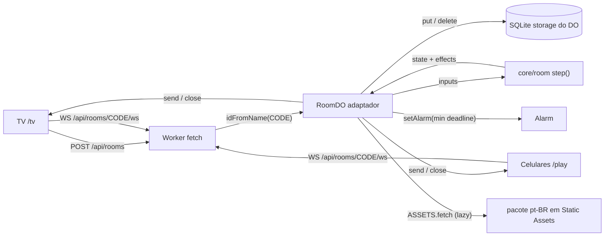

# M2 Room Server Design

**Spec**: `.specs/features/m2-room-server/spec.md`
**Status**: Approved - 2026-10-27 - user: "ok concordo com a opção A"

---

## Architecture Overview

### Abordagens consideradas

| Abordagem | Como funciona | Prós | Contras |
| --- | --- | --- | --- |
| **A - Máquina de estados pura no `core` + DO fino (recomendada)** | Toda regra da sala é uma função pura `step(state, input, now, deps) → { state, effects }` em `packages/core/src/room/`. O Durable Object só traduz sockets, storage e alarm em inputs e executa os effects | Regras testadas em Node em milissegundos, com relógio injetado; o `core` continua independente do runtime (DESIGN §6.3); M3/M4 importam os mesmos tipos | Uma camada de effects a mais para escrever |
| B - Lógica dentro da classe do DO | Os handlers do DO mudam o estado e mandam mensagens direto | Menos indireção | Toda regra só se testa no workerd, mais lento e sem controle fino do relógio; amarra as regras ao runtime da Cloudflare |
| C - Um DO por sala + um DO "registro" de códigos | Um DO central sorteia e reserva os códigos | Listagem global de salas | Ponto central e uma requisição a mais por sala; o `idFromName(code)` já garante a unicidade sem registro |

Escolha: **A**, aprovada pelo user ("ok concordo com a opção A") depois de comparar o que a B perderia: testes rápidos com relógio injetado, o `core` independente do runtime (DESIGN §6.3), servidor falso para o M3/M4 e provas sobre todas as mensagens enviadas. Os testes de integração no workerd (M2-Q2) cobrem o adaptador e uma partida inteira; as regras ficam testadas na camada pura.

### Componentes e fluxo



### Uma rodada

```mermaid
sequenceDiagram
  participant H as Celular anfitrião
  participant P as Celular jogador
  participant DO as RoomDO
  participant TV
  H->>DO: start
  DO->>DO: tabuleiro (pré-gerado ou gerado), salt, hash prefixes
  DO-->>TV: round-start {board, startsAt, endsAt}
  DO-->>P: round-start {board, startsAt, endsAt, salt} + frame binário de hashes
  P->>P: ✓/✗ local pelos hashes; debounce 500 ms (M3)
  P->>DO: submit {paths}
  DO-->>P: submit-result {results}
  DO-->>TV: counts (no máximo 1x/s, via alarm de flush)
  Note over DO: alarm em endsAt + 300 ms
  DO-->>TV: counts finais
  DO-->>TV: round-results
  DO-->>P: round-results
  DO->>DO: gera o próximo tabuleiro e os hashes
```

---

## Code Reuse Analysis

### Existing Components to Leverage

| Component | Location | How to Use |
| --- | --- | --- |
| `LanguagePack.fromBuffers` | `packages/core/src/pack.ts` | Carregar o pacote no DO a partir dos arquivos de `dist/pt-BR/` |
| `generateBoard` | `packages/core/src/generator.ts` | Gerar o tabuleiro com tamanho, semente e filtro da sala |
| `boardSolutions` | `packages/core/src/validate.ts` | Soluções da rodada (com mínimo e filtro) para os hashes e a validação |
| `validateSubmission` | `packages/core/src/validate.ts` | Validar cada caminho (ROUND-01 AC 3) |
| `scoreRound`, `wordPoints` | `packages/core/src/scoring.ts` | Pontos, palavras únicas e em comum (RES-01 AC 1) |
| `pickLongestWord` | `packages/core/src/longest.ts` | Maior palavra (RES-01 AC 3) |
| `LanguagePack.spellings` | `packages/core/src/pack.ts` | Grafias reais (RES-01 AC 2) |
| `boardTiles`, `solve` | `packages/core/src/solver.ts` | Base do novo `findPath` |
| `buildDawg`, `buildSpellings` | `packages/core/src/dawg.ts`, `spellings.ts` | Montar o pacote de fixture dos testes |
| Padrão do Worker do M0 | `spikes/m0/src/worker.ts`, `spikes/m0/wrangler.jsonc` | `ASSETS.fetch('https://assets.local/...')` dentro do DO, `new_sqlite_classes`, `observability` |

### Integration Points

| System | Integration Method |
| --- | --- |
| Static Assets | O `wrangler.jsonc` do servidor aponta `assets.directory` para `tools/dict-build/dist`; o DO busca `pt-BR/*` uma vez por isolate (M0: 17 ms a frio, 760 ms com o asset fora do cache logo após um deploy) |
| SQLite storage do DO | KV API (`ctx.storage.get/put/delete/deleteAll`) sobre o backend SQLite; o único disponível no plano Free |
| npm workspaces | Novo workspace `packages/server` (`@bwords/server`), dependente de `@bwords/core` |
| Vitest | `vitest.config.ts` da raiz passa a ter dois `projects`: o atual (Node) e `packages/server` com o plugin da Cloudflare |

---

## Components

### Protocol (`core`)

- **Purpose**: Tipos e parser estrito de todas as mensagens (PROTO-01), em inglês (AD-001).
- **Location**: `packages/core/src/room/protocol.ts`
- **Interfaces**:
  - `type ClientMessage` - união: `hello`, `join`, `settings`, `start`, `submit`, `next`, `transfer-host`, `kick`, `play-again`, `back-to-lobby`, `close-room`, `time`
  - `type ServerMessage` - união: `welcome`, `joined`, `players`, `settings`, `round-start`, `submit-result`, `counts`, `round-results`, `podium`, `time`, `error`, `closed`
  - `type ErrorCode` - `bad-message`, `wrong-phase`, `not-host`, `bad-token`, `room-not-found`, `bad-nickname`, `nickname-taken`, `bad-color`, `color-illegible`, `color-too-similar`, `room-full`, `bad-settings`, `bad-target`
  - `type SubmitReject = RejectReason | 'round-closed' | 'spectator' | 'rate-limited'`
  - `type CloseReason` - `kicked`, `closed-by-host`, `idle`, `tv-gone`, `replaced`
  - `parseClientMessage(raw: string): ClientMessage | null` - rejeita > 4.096 bytes antes do `JSON.parse`, tipo desconhecido e campos fora do formato
  - `encodeHashFrame(roundId: number, prefixes: Uint8Array): ArrayBuffer` / `decodeHashFrame(buf): {...}` - frame binário: `u8 kind=1`, `u32 roundId`, depois N × 6 bytes
- **Dependencies**: nenhuma
- **Reuses**: `RejectReason` de `validate.ts`

### Room rules (`core`)

- **Purpose**: A sala inteira como máquina de estados pura.
- **Location**: `packages/core/src/room/machine.ts` (+ `state.ts`)
- **Interfaces**:
  - `createRoom(code: string, tvToken: string, now: number, cfg: RoomConfig): RoomState`
  - `step(state: RoomState, input: RoomInput, now: number, deps: RoomDeps): StepResult`
  - `type RoomInput` - `{ kind: 'message', conn: ConnRef, msg: ClientMessage }` · `{ kind: 'connect', conn }` · `{ kind: 'disconnect', conn }` · `{ kind: 'alarm' }`
  - `type Effect` - `send(to, msg)` · `sendHashes(to, frame)` · `close(to, reason)` · `persist(keys)` · `prepareRound()` · `closeRoom(reason)`
  - `nextDeadline(state): number | null` - menor entre fim da rodada + 300 ms, troca de anfitrião, flush da TV, ociosidade e TV ausente
  - `type RoomDeps` - `randomToken()`, `randomSalt()`, serviços do pacote já carregado (gerar tabuleiro, soluções, maior palavra, caminho, grafias)
- **Dependencies**: `protocol.ts`, `colors.ts`, `nickname.ts`
- **Reuses**: `validateSubmission`, `scoreRound`, `pickLongestWord` (via `deps`)

O relógio entra como parâmetro: no Workers o `Date.now()` só avança em I/O (fato registrado no M0), e o teste controla o tempo sem fake timers.

### Colors (`core`)

- **Purpose**: Legibilidade e semelhança de cor (JOIN-01 AC 4-6, 11).
- **Location**: `packages/core/src/room/colors.ts`
- **Interfaces**: `TV_BACKGROUND = '#12131a'`, `PALETTE: readonly string[]` (10), `parseHex(s)`, `contrastRatio(a, b)` (WCAG 2.x), `ciede2000(a, b)`, `checkColor(color, others): ErrorCode | null`
- **Reuses**: nada; fórmulas de referência (WCAG relative luminance; Sharma et al. 2005 para CIEDE2000, com os pares de teste publicados)

### Nickname (`core`)

- **Purpose**: Regras do apelido (JOIN-01 AC 2-3).
- **Location**: `packages/core/src/room/nickname.ts`
- **Interfaces**: `cleanNickname(s): string | null` (trim, NFC, 2-12 code points, sem caracteres de controle), `nicknameKey(s)` (NFD, remove diacríticos, `toLowerCase`)

### Room code e tokens (`core`)

- **Location**: `packages/core/src/room/codes.ts`
- **Interfaces**: `ROOM_CODE_ALPHABET = 'ABCDEFGHJKLMNPQRSTUVWXYZ'`, `randomRoomCode(rand)`, `isRoomCode(s)`; tokens de 16 bytes aleatórios em base64url (gerados pelo adaptador com `crypto.getRandomValues`)

### Salted hashes (`core`)

- **Purpose**: Prefixo de 6 bytes do SHA-256(salt ‖ palavra) (ROUND-01 AC 2, M2-Q7). O celular usa a mesma função no M3.
- **Location**: `packages/core/src/room/hashes.ts`
- **Interfaces**: `HASH_PREFIX_BYTES = 6`, `hashPrefix(salt: Uint8Array, word: string): Promise<Uint8Array>`, `hashPrefixes(salt, words): Promise<Uint8Array>` (Web Crypto, disponível em workerd, Node 24 e navegadores)

### Path finder (`core`)

- **Purpose**: Caminho de peças de uma palavra no tabuleiro, para a maior palavra (RES-01 AC 3) e para os testes.
- **Location**: `packages/core/src/path.ts`
- **Interfaces**: `findPath(board: Board, word: string): number[] | null` - DFS nas 8 direções, respeitando peças compostas ("Qu")
- **Reuses**: `boardTiles`

### Worker (`server`)

- **Purpose**: Roteamento HTTP e upgrade de WebSocket.
- **Location**: `packages/server/src/worker.ts`
- **Interfaces**:
  - `POST /api/rooms` → sorteia um código, chama `stub.create()` (RPC); se a sala existe, sorteia de novo (ROOM-01 AC 2); responde `{ code, tvToken }`
  - `GET /api/rooms/:code/ws` (Upgrade) → encaminha ao DO de `idFromName(code)`; código mal formado → aceita, manda `error room-not-found` e fecha
  - Outras rotas → 404 (os bundles de TV e celular chegam no M3/M4)

### RoomDO (`server`)

- **Purpose**: Adaptador: sockets, storage, alarm e pacote → `step()`.
- **Location**: `packages/server/src/room-do.ts`
- **Interfaces**:
  - `create(cfg): Promise<{ tvToken } | null>` (RPC)
  - `fetch(req)` - aceita o WebSocket com `ctx.acceptWebSocket(server, ['pending'])`
  - `webSocketMessage(ws, data)` · `webSocketClose(ws, ...)` · `webSocketError(ws, ...)` · `alarm()`
  - Constructor: `blockConcurrencyWhile` lê `room` e `round` do storage; `setWebSocketAutoResponse(new WebSocketRequestResponsePair('ping', 'pong'))` (RECON-01 AC 6, sem acordar o DO)
  - `now` como campo substituível (`this.clock = () => Date.now()`), trocado nos testes via `runInDurableObject`
- **Identificação da conexão**: `hello` é a primeira mensagem (`{role:'tv'|'player', token?}`); o token nunca vai na URL. Depois do `hello`/`join`, o socket recebe tags (`tv` ou `player:<id>`) e um attachment `{ role, playerId }` (< 16 KB), que sobrevive à hibernation
- **Effects**: `persist` grava só as chaves tocadas; `send`/`close` usam `ctx.getWebSockets(tag)`; depois de cada input, `setAlarm(nextDeadline)` ou `deleteAlarm()`
- **Rate limit**: janela de 1 s por jogador em memória; a hibernation só ocorre depois de vários segundos sem eventos, então perder a janela não abre brecha

### Pack loader (`server`)

- **Location**: `packages/server/src/pack-loader.ts`
- **Interfaces**: `loadPack(assets: Fetcher, id: string): Promise<LanguagePack>` - cache por isolate; só é chamado quando o input precisa do pacote (gerar tabuleiro, montar resultado). Validar um envio usa as soluções guardadas na rodada e não carrega o pacote (G7)

### Config (`server`)

- **Location**: `packages/server/src/config.ts`
- **Interfaces**: `readConfig(env): { idleMin: number; tvGoneMin: number }` - inteiro ≥ 0, senão o padrão (EXP-01 AC 1, 6)

---

## Data Models

### Estado em memória (`core`)

```typescript
type Phase = 'lobby' | 'round' | 'results' | 'podium';

interface RoomState {
  code: string;
  tvToken: string;
  phase: Phase;
  settings: Settings;
  players: Player[];            // ordem de entrada
  hostId: string | null;
  hostOfflineSince: number | null;
  tvOfflineSince: number | null;
  lastActionAt: number;
  roundIndex: number;           // 0-based dentro da partida
  round: RoundMeta | null;      // tabuleiro e tempos da rodada atual
  nextRound: RoundMeta | null;  // pré-gerado no resultado (RES-01 AC 4)
  tvCounts: { dirty: boolean; lastSentAt: number };
}

interface Settings {
  size: 4 | 5 | 6; seconds: 30 | 60 | 90 | 120 | 150 | 180; rounds: 1 | 2 | 3 | 4 | 5;
  minLength: 3 | 4; filterProfanity: boolean; fastMode: boolean; pack: 'pt-BR';
  volume: number; muted: boolean;
}

interface Player {
  id: string; token: string; nickname: string; color: string;
  joinedAt: number; connected: boolean; spectator: boolean; score: number;
}

interface RoundMeta {
  id: number; board: string[][]; startsAt: number; endsAt: number;
  salt: string;                 // base64url, 16 bytes
}
```

### Storage (KV API sobre SQLite)

| Chave | Conteúdo | Quando grava |
| --- | --- | --- |
| `room` | `RoomState` sem as palavras | Toda mudança que não é envio, e com cada envio aceito, para guardar o `lastActionAt` (achado 3 do Verifier) |
| `round:solutions` | Soluções da rodada atual (`string[]`) + prefixos de hash (`Uint8Array`) | Uma vez por rodada |
| `round:next` | Mesmo formato, da rodada pré-gerada | Uma vez, no resultado |
| `found:<playerId>` | Palavras aceitas do jogador na rodada (`string[]`) | Uma vez por mensagem `submit` com pelo menos um aceito |

Orçamento de rows written (plano Free: 100.000/dia; incluídas na fonte de pricing em Sources). Uma rodada de 10 jogadores com o debounce de 500 ms dá algumas centenas de writes (duas por lote aceito, `found:<playerId>` e `room`, uma por lote recusado, só `room`, raro porque o celular filtra pelos hashes, mais ~10 de estado), o que ainda cabe em centenas de rodadas por dia. As mensagens recebidas contam 20:1 como requests (100.000/dia), e o `ping` com auto-response não conta duration.

---

## Error Handling Strategy

| Error Scenario | Handling | User Impact |
| --- | --- | --- |
| Mensagem inválida, > 4 KB ou tipo desconhecido | `error bad-message`; estado intacto | Cliente mostra erro genérico (M3/M4) |
| Comando fora da fase / de quem não é anfitrião | `error wrong-phase` / `not-host` | Botão sem efeito; cliente pode avisar |
| Token desconhecido no `hello` | `error bad-token` + `close` | Cliente apaga o token e volta à entrada |
| Código sem sala | `error room-not-found` + `close` | Tela de "sala não encontrada" |
| Falha ao buscar o pacote no `ASSETS` | O input que precisava do pacote não muda o estado; `error` interno logado; o anfitrião pode tentar de novo | `start` sem efeito; rara (o asset está no mesmo Worker) |
| DO recriado no meio da rodada | Constructor recarrega `room` e `round:*`; o alarm persistido dispara o fim | Nenhum; a rodada termina na hora certa |
| Gerador esgota as 200 tentativas | `start`/`next` falham com `error` interno e o estado fica no lobby/resultado | O anfitrião tenta de novo (improvável com os mínimos calibrados no M1) |

---

## Testing Strategy

| Camada | Ferramenta | O que cobre |
| --- | --- | --- |
| `core/room/*` | Vitest em Node (projeto atual) | Todas as regras de JOIN, HOST, CFG, ROUND, RES, EXP e PROTO com relógio injetado: janela de 300 ms, rate limit, 30 s do anfitrião, ociosidade, throttle da TV, ordem do resultado |
| `core/path.ts`, `hashes.ts`, `colors.ts` | Vitest em Node | `findPath` com "Qu"; prefixo de 6 bytes com vetores fixos; CIEDE2000 com os pares de Sharma et al.; paleta |
| `packages/server` | Vitest + `@cloudflare/vitest-plugin` no workerd | ROOM, RECON, PERSIST e a partida inteira por WebSocket: `evictDurableObject` (persistência e hibernation), `runDurableObjectAlarm` (fim da rodada, anfitrião, expiração), `runInDurableObject` (relógio, storage) |

O pacote dos testes do servidor é uma fixture pequena, montada com `buildDawg`/`buildSpellings` a partir de uma lista fixa de palavras, com `minCommonWords` 0. Os testes leem o tabuleiro do `round-start` e usam `boardSolutions` + `findPath` para montar caminhos válidos, sem depender de sementes.

---

## Risks & Concerns

| Concern | Location (file:line) | Impact | Mitigation |
| --- | --- | --- | --- |
| `@cloudflare/vitest-pool-workers` foi renomeado para `@cloudflare/vitest-plugin` (o npm marca o antigo como "will not receive future updates"); a doc oficial ainda cita o nome antigo | `vitest.config.ts` | Configuração quebrada ou API diferente da documentada | Usar `@cloudflare/vitest-plugin` 1.4.x (peer `vitest ^4.1`, compatível com o 4.1.12 instalado); a primeira tarefa do servidor é um teste "hello" que prova a configuração |
| A doc diz que `exports` não expõe Assets nos testes | `packages/server` | O DO pode não achar o pacote via `ASSETS` no teste | O pack loader recebe um `Fetcher`; os testes passam um `ASSETS` de fixture pela config do plugin ou, se não der, um `Fetcher` em memória. Decidido na tarefa "hello" |
| `validateSubmission` exige `ctx.pack` só para o filtro de palavrões | `packages/core/src/validate.ts:62` | Validar após um wake obrigaria a carregar o pacote (G7) | As soluções guardadas já vêm filtradas; o DO passa `filterProfanity: false` com essas soluções, e um teste prova que palavrão filtrado continua recusado |
| `generateBoard` usa `minCommonWords` do pacote; a fixture não tem palavras comuns suficientes | `packages/core/src/generator.ts:102` | Gerador falha nos testes | Fixture com `minCommonWords: {}` |
| Primeiro `ASSETS.fetch` após deploy levou 760 ms no M0 | `docs/m0-results.md:145` | Primeiro "start" de uma sala logo após um deploy demora | Carregar o pacote já no `create()` da sala, enquanto a TV mostra o lobby |
| `spellings.bin` tem 6,79 MB, 4x o dicionário (achado ao extrair o design do M1) | `pack-loader.ts` | Carregar o pacote inteiro em toda sala gasta memória e tempo por nada | O loader busca `spellings.bin` só quando o primeiro resultado precisa das grafias, e guarda em cache por isolate |
| Static Assets são públicos: com o pacote na pasta de assets, `/pt-BR/dict.bin` respondia 200 (achado no `wrangler dev`, padrão herdado do M0) | `packages/server/wrangler.jsonc` | Qualquer um baixa o dicionário e monta um solver, contra o DESIGN §5.3 | `run_worker_first: true`; o Worker nunca serve os arquivos e só o DO lê pelo `ASSETS` (T31, PROTO-01 AC 8) |
| Rows written: 100.000/dia no Free | storage | Muitas salas num dia esgotam a cota e as gravações falham | Gravar só deltas (tabela acima); registrar no relatório do M5 a conta real |
| Auto-reply de Close frames só com `compatibility_date` ≥ 2026-04-07 | `wrangler.jsonc` | Sockets presos em CLOSING | Usar uma data ≥ 2026-04-07 suportada pelo wrangler 4.153 instalado, ou chamar `ws.close()` no `webSocketClose` |

---

## Tech Decisions (only non-obvious ones)

| Decision | Choice | Rationale |
| --- | --- | --- |
| Onde ficam as regras | `core/room` puro; DO como adaptador | Testes rápidos, relógio injetado, `core` sem runtime (DESIGN §6.3) |
| Unicidade do código | `idFromName(code)` + `create()` que recusa sala ativa | Dispensa registro central |
| Token | Na primeira mensagem (`hello`), nunca na URL | Não vaza em logs de URL |
| Frame dos hashes | Um frame binário separado; o resto é JSON | 6 bytes por palavra sem inflar com base64 (M2-Q7); mediana de 1.424 palavras no 6x6 = ~8,5 KB, máximo ~25 KB |
| Contagem já como a TV precisa | Throttle de 1 s com alarm de flush e envio final antes do resultado | M2-Q6 |
| Persistência | KV API do SQLite, uma chave por grupo de dados, gravando só o que mudou | Rows written é a cota mais apertada do Free |
| Envio após gravar | `put` sem `await` seguido de `send`: o output gate do DO segura o envio até a gravação confirmar | PERSIST-01 AC 1 sem latência extra |
| Contagem regressiva | Fase `round` com `startsAt`; envios antes de `startsAt` dão `round-closed` | Uma fase a menos; a contagem é só um intervalo de tempo |

---

## Sources

- `docs/m0-results.md` - carga a frio 17 ms (760 ms com asset fora do cache), solver 6x6 p95 17 ms CPU, geração p95 14 ms, 408-4.240 palavras por 6x6 (mediana 1.424), memória 10 MB
- `.specs/features/m0-dictionary-spike/spec.md` - 128 MB por isolate, 30 s de CPU por mensagem, 1 s de inicialização, 25 MiB por asset; `Date.now()`/`performance.now()` não avançam em execução síncrona
- https://developers.cloudflare.com/durable-objects/platform/pricing/ - Free: 100.000 requests/dia, mensagens recebidas 20:1, 13.000 GB-s/dia, 100.000 rows written/dia, 5 GB
- https://developers.cloudflare.com/durable-objects/best-practices/websockets/ - attachment ≤ 16.384 bytes; ping frames respondidos sem acordar; constructor roda de novo no wake
- https://developers.cloudflare.com/durable-objects/api/state/ - tags (≤ 10, ≤ 256 caracteres), `setWebSocketAutoResponse` (≤ 2.048 caracteres, não acorda o DO), `blockConcurrencyWhile` (30 s)
- https://developers.cloudflare.com/workers/testing/vitest-integration/test-apis/ - `runInDurableObject`, `runDurableObjectAlarm`, `evictDurableObject`
- npm: `@cloudflare/vitest-plugin` 1.4.8 (peer `vitest ^4.1.0 || ^5.0.0`); `@cloudflare/vitest-pool-workers` 0.23.0 marcado como renomeado
