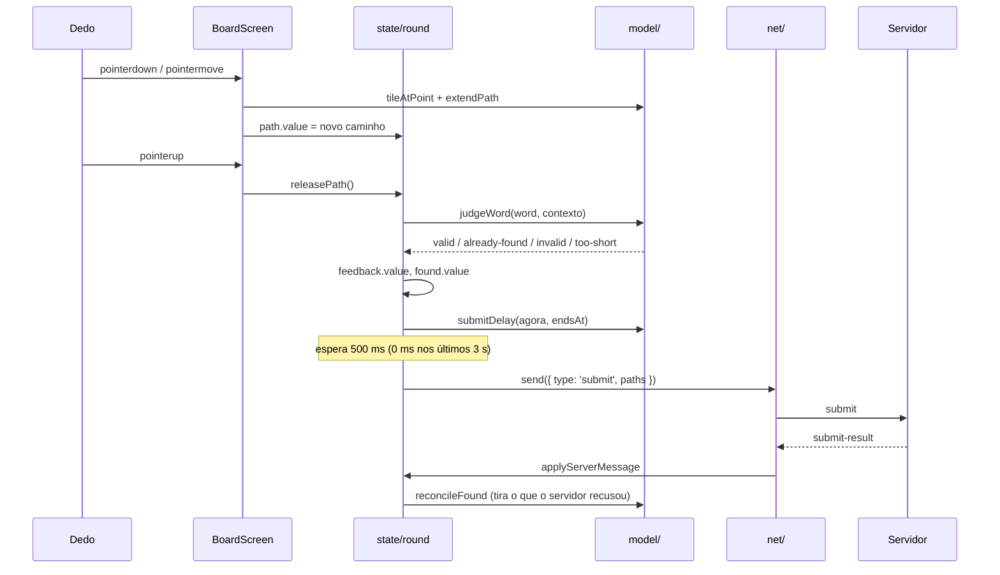

# M3 Phone Design

**Spec**: `.specs/features/m3-phone/spec.md`
**Status**: Approved - 2026-10-29 - user: "Aprovo o design"

O design segue o `docs/style-guide.md`: estrutura do cliente Preact (§2.1), legibilidade (§3.1), SOLID (§4), componentização (§5) e Signals + ESLint (AD-015).

---

## Architecture Overview

O celular é um cliente fino do protocolo do M2. Toda decisão que muda o que o jogador vê roda em funções puras de `model/`, testadas com Vitest. Os signals de `state/` só guardam o resultado dessas funções. As telas leem os signals; os componentes recebem props.

```mermaid
flowchart LR
    subgraph platform[Navegador]
      WS[WebSocket]
      DOM[Pointer events / Wake Lock / Vibrate / Audio]
    end
    subgraph phone[packages/phone]
      NET[net/RoomConnection]
      STATE[state/ signals + actions]
      MODEL[model/ funções puras]
      SCREENS[screens/]
      COMP[components/]
      DEVICE[device/ adaptadores]
    end
    CORE[@bwords/core]

    WS <--> NET
    NET -- mensagens do servidor --> STATE
    STATE -- send --> NET
    STATE -- calcula com --> MODEL
    MODEL --> CORE
    NET --> CORE
    SCREENS -- lê signals, chama actions --> STATE
    SCREENS -- props --> COMP
    COMP -- callbacks --> SCREENS
    STATE --> DEVICE
    DEVICE --> DOM
```

**Fluxo de uma palavra** (PLAY-01 AC 6-13):



---

## Code Reuse Analysis

### Existing Components to Leverage

| Component | Location | How to Use |
| --- | --- | --- |
| Tipos e mensagens do protocolo | `packages/core/src/room/protocol.ts` | `ClientMessage`, `ServerMessage`, `WelcomeMessage`, `Settings`, `PlayerInfo`, `RoundInfo`, `RoundResultsMessage`, `PodiumEntry`, `ErrorCode`, `CloseReason` |
| Quadro binário de hashes | `protocol.ts` (`decodeHashFrame`, `HASH_FRAME_KIND`) | `net/` decodifica o quadro da rodada |
| Hash da palavra | `packages/core/src/room/hashes.ts` (`hashPrefix`, `HASH_PREFIX_BYTES`) | `model/judge.ts` compara o prefixo da palavra formada com o conjunto da rodada |
| Peças do tabuleiro | `packages/core/src/solver.ts` (`Board`, `boardTiles`) | `model/path.ts` monta a palavra de um caminho |
| Pontos | `packages/core/src/scoring.ts` (`wordPoints`) | Pontos do feedback "VÁLIDA (+N PTS)" e do contador |
| Paleta e cores | `packages/core/src/room/colors.ts` (`PALETTE`, `ciede2000`, `checkColor`) | Seletor de cor; achar o dono da cor mais parecida (JOIN-01 AC 8) |
| Apelido | `packages/core/src/room/nickname.ts` (`NICKNAME_MIN`, `NICKNAME_MAX`, `cleanNickname`) | Contador "N/12" e limpeza antes do `join` |
| Coroa | `packages/core/src/room/wins.ts` (`crownedPlayers`) | Lista do lobby e classificação |
| Código da sala | `packages/core/src/room/codes.ts` (`ROOM_CODE_ALPHABET`, `ROOM_CODE_LENGTH`, `isRoomCode`) | Tela "Entrar numa sala" e leitura de `/<código>` |
| Limite de envios | `packages/core/src/room/submit.ts` (`RATE_LIMIT_PATHS`, `RATE_WINDOW_MS`) | O agrupamento de envios nunca passa do limite |
| Cliente de referência | `tools/debug/src/socket.ts` | Padrão de `hello`, `binaryType`, `wsUrl` e redução de mensagens; o celular reescreve isso separado em `net/` e `model/`, sem copiar a mistura de UI e rede do debug |
| Config do Vite com proxy | `tools/debug/vite.config.ts` | Mesmo proxy de `/api` para o `wrangler dev` |
| Fixtures e helpers de teste | `packages/core/src/room/test-helpers.ts` | Formato das mensagens nos testes do reducer |

### Integration Points

| System | Integration Method |
| --- | --- |
| Servidor (`packages/server`) | WebSocket em `/api/rooms/:code/ws`, só pelo protocolo; em dev, pelo proxy do Vite para `wrangler dev` (8787) |
| TV nos testes | A página de debug (`tools/debug`) ou um helper Node que cria a sala (`POST /api/rooms`) e abre o socket da TV |
| Vitest | O projeto `core` do `vitest.config.ts` já inclui `packages/*/src/**/*.test.ts`; os testes do celular rodam em Node, sem DOM, porque `model/` e `state/` são puros |
| Playwright | Config própria em `packages/phone/playwright.config.ts`, com `wrangler dev` e o Vite do celular como `webServer` |

---

## Components

A estrutura segue o style guide §2.1. Abaixo, cada camada com o que expõe.

### net/RoomConnection

- **Purpose**: manter um WebSocket com a sala: `hello`, reconexão, clock sync e entrega das mensagens.
- **Location**: `packages/phone/src/net/room-connection.ts`, `net/clock-sync.ts`
- **Interfaces**:
  - `createRoomConnection(options: ConnectionOptions): RoomConnection`
  - `RoomConnection.connect(code: string, token: string | null): void`
  - `RoomConnection.send(msg: ClientMessage): void`
  - `RoomConnection.retry(): void` - usado por "Tentar de novo"
  - `RoomConnection.close(): void`
  - `ConnectionOptions = { openSocket: (url: string) => WebSocket; now: () => number; onMessage(msg: ServerMessage): void; onHashes(frame: HashFrame): void; onStatus(status: ConnectionStatus): void }`
- **Behavior**:
  - Reconecta com espera crescente (0,5 s, 1 s, 2 s, até 4 s). Depois de 30 s sem sucesso, avisa `offline` e para (RECON-01 AC 4).
  - Não reconecta depois de uma mensagem `closed` (EXIT-01).
  - Clock sync: manda `time` três vezes ao abrir e fica com a amostra de menor ida e volta (`offset = serverTime - (sent + received) / 2`).
- **Dependencies**: `@bwords/core` (tipos, `decodeHashFrame`).
- **Reuses**: o padrão de `tools/debug/src/socket.ts`.

### state/ (Signals)

- **Purpose**: guardar o estado do celular em signals e expor as ações das telas.
- **Location**: `packages/phone/src/state/`
  - `room.ts` - `room` (o `RoomView`), `connection`, e as ações de sala: `openRoom`, `join`, `changeSettings`, `start`, `next`, `transferHost`, `kick`, `playAgain`, `backToLobby`, `closeRoom`
  - `round.ts` - `path`, `feedback`, `pendingPaths` e as ações `extendPathTo(tile)`, `releasePath()`; dono do timer de envio
  - `match.ts` - `matchHistory`, para o resumo do pódio (AD-007)
  - `prefs.ts` - `prefs` (`vibrate`, `sound`), lidos e gravados no `localStorage`
  - `derived.ts` - `computed` para a tela: `screen`, `me`, `isHost`, `standings`, `remainingMs`
- **Interfaces**: cada ação é uma função sem retorno que calcula o próximo valor com `model/` e atribui ao signal.
- **Dependencies**: `net/`, `model/`, `device/`, `@preact/signals`.
- **Testes**: Vitest com um `RoomConnection` falso e relógio injetado (`createPhoneStore({ connection, now, storage })`). Por isso o store é criado por uma fábrica, não como singleton de módulo; `main.tsx` cria o store real e o entrega pelo contexto do Preact.

### model/ (funções puras)

| Módulo | Funções | Requisitos |
| --- | --- | --- |
| `room-view.ts` | `applyServerMessage(view, msg): RoomView`, `INITIAL_VIEW` | todos |
| `screen.ts` | `screenFor(view, connection): Screen` - qual tela mostrar pela fase, pelo papel e pelo estado da conexão | todos |
| `path.ts` | `isNeighbor(size, a, b)`, `extendPath(path, tile, size): Path`, `wordOfPath(board, path): string` | PLAY-01 AC 2-5 |
| `hit-test.ts` | `tileAtPoint(point, boardRect, size, hitRatio): number \| null` - só o círculo central de raio 35% conta | PLAY-01 AC 2 |
| `judge.ts` | `judgeWord(word, ctx): Promise<Feedback>`, com a ordem: muito curta → já encontrada → hash | PLAY-01 AC 6-10 |
| `submit-queue.ts` | `submitDelay(now, endsAt): number` (500 ms ou 0 nos últimos 3 s), `takeBatch(pending, sentInWindow)` (respeita `RATE_LIMIT_PATHS`) | PLAY-01 AC 12 |
| `found.ts` | `reconcileFound(found, results)` - tira as palavras recusadas e desconta os pontos | PLAY-01 AC 13 |
| `clock.ts` | `formatClock(ms): string` ("01:47"), `countdownNumber(now, startsAt): 3 \| 2 \| 1 \| null`, `isAlert(remainingMs)` | COUNT-01, PLAY-01 AC 14-15 |
| `players.ts` | `lobbyRows(players, hostId, myId)`, `quickScoreboard(players)`, `podiumRows(ranking, players)` - ordem, coroa, etiquetas, espectadores por último | LOBBY-01, RES-01 AC 6, POD-01 AC 7 |
| `results.ts` | `myWordRows(found, results)` - "ÚNICA ×2", "em comum", grafias e pontos base; `myRoundSummary(results, myId)` - pontos da rodada, total e posição | RES-01 AC 2-5 |
| `match-summary.ts` | `addRound(history, myWords)`, `matchSummary(history): { wordCount, longest }` | POD-01 AC 4-6 |
| `colors.ts` | `colorSlots(PALETTE, players, myId)` (livre, minha, bloqueada com dono), `closestColorOwner(color, players)` | JOIN-01 AC 2-3, 8 |
| `settings.ts` | `stepSeconds(seconds, delta)`, `stepRounds(rounds, delta)`, `canStep(...)` - limites de 30-180 s e 1-5 rodadas | HOST-01 AC 3-5 |
| `room-code.ts` | `parseRoomPath(pathname): string \| null`, `typeCodeLetter(code, index, letter)` (maiúscula, só o alfabeto da sala) | ENTRY-01 |
| `messages.ts` | `errorKey(code: ErrorCode): StringKey`, `closeKey(reason: CloseReason): StringKey` | JOIN-01 AC 6-10, EXIT-01 |

### screens/

Uma tela por arquivo. Cada tela lê os signals e as ações do store e repassa props.

| Tela | Capture | Requisitos |
| --- | --- | --- |
| `CodeEntryScreen` | `phone-code.png` | ENTRY-01 AC 2-5 |
| `JoinScreen` | `phone-join.png` | ENTRY-01 AC 1, JOIN-01 |
| `LobbyScreen` | `phone-lobby.png` | LOBBY-01 |
| `HostLobbyScreen` + `PlayerActionsSheet` | `phone-host-lobby.png`, `phone-host-actions.png` | HOST-01 |
| `CountdownScreen` | `phone-countdown.png` | COUNT-01 |
| `BoardScreen` | `phone-board.png`, `phone-feedbacks.png` | PLAY-01, HOSTPLAY-01 |
| `SpectatorScreen` | `phone-spectator.png` | SPEC-01 |
| `RoundResultScreen` | `phone-round-result.jpg` | RES-01 |
| `PodiumScreen` | `phone-podium.jpg` | POD-01 |
| `KickedScreen`, `RoomClosedScreen`, `ReplacedScreen` | `phone-kicked.png`, `phone-room-closed.png` | EXIT-01 |

`app.tsx` escolhe a tela por uma tabela `Screen → componente` (aberto/fechado, §4). Por cima de qualquer tela ficam a `ReconnectBanner` (RECON-01), a `PrefsSheet` (PREF-01) e o `ConfirmDialog`.

### components/

Peças sem rede nem store, só props e callbacks (style guide §5):

`TopBar` (etiqueta da sala, ícone de preferências, menu ⋮), `RoomTag`, `PlayerAvatar` (círculo com a inicial), `PlayerRow`, `Chip`, `Tile`, `BoardGrid` (peças + linha do caminho em SVG), `WordRack` (palavra em formação), `FeedbackPill`, `FoundWords`, `Stepper`, `Segmented`, `Toggle`, `VolumeSlider`, `ColorPicker`, `Sheet`, `ConfirmDialog`, `ReconnectBanner`, `PrimaryButton`, `SecondaryButton`, `Confetti`, `icons.tsx` (ícones em SVG inline).

### device/

- **Purpose**: isolar as APIs do navegador que os testes em Node não têm.
- **Location**: `packages/phone/src/device/`
- **Interfaces**: `wakeLock.request()/release()` (PREF-01 AC 4), `canVibrate()`, `vibrate(ms)` (PLAY-01 AC 18, PREF-01 AC 3), `playHitSound()` (PLAY-01 AC 19, um bipe curto gerado com Web Audio, sem arquivo de áudio), `storage` (`localStorage` com `try/catch`).
- **Dependencies**: nenhuma. O store recebe essas funções pela fábrica, então os testes passam versões falsas (inversão de dependência, §4).

### strings/ e styles/

- `strings/pt-BR.ts`: um objeto `STRINGS` com chaves tipadas e funções para textos com valores (`waitingForHost(name)`, `roundOf(n, m)`). Todo `ErrorCode` e `CloseReason` tem chave (garantido por um teste).
- `styles/tokens.css`: as cores das captures (fundo `#12131a`, superfícies `#1a1b22` a `#34343c`, primária `#ff7a00`, válida `#00b869`, inválida `#93000a`, alerta em amarelo, texto `#e3e1ec`), espaços e raios. As cores dos jogadores vêm do `PALETTE` do `core`, nunca do CSS.

---

## Data Models

```ts
/** Everything the phone knows about the room, built only from server messages. */
interface RoomView {
  code: string | null;
  phase: Phase | null;
  settings: Settings | null;
  players: PlayerInfo[];
  hostId: string | null;
  myId: string | null;
  round: RoundInfo | null;
  salt: Uint8Array | null;
  /** Prefixes of the round's valid words, as `hex` strings for set lookup. */
  hashes: ReadonlySet<string>;
  /** Words this phone found this round, newest first. */
  found: FoundWord[];
  results: RoundResultsMessage | null;
  podium: PodiumEntry[] | null;
  joinError: ErrorCode | null;
  closeReason: CloseReason | null;
}

interface FoundWord {
  word: string;
  points: number;
  /** True once the server accepted it in a `submit-result`. */
  confirmed: boolean;
}

type ConnectionStatus = 'connecting' | 'open' | 'reconnecting' | 'offline' | 'closed';

type Feedback =
  | { kind: 'valid'; word: string; points: number }
  | { kind: 'already-found'; word: string }
  | { kind: 'invalid'; word: string }
  | { kind: 'too-short'; word: string };

type Screen =
  | 'code-entry' | 'join' | 'lobby' | 'host-lobby' | 'countdown' | 'board' | 'spectator'
  | 'round-result' | 'podium' | 'kicked' | 'room-closed' | 'replaced';

/** One finished round, as this phone saw it, for the podium summary (AD-007). */
interface RoundRecord {
  index: number;
  words: { word: string; points: number; spellings?: string[] }[];
}

interface Prefs {
  vibrate: boolean;
  sound: boolean;
}
```

**Relationships**:
- `RoomView` é reconstruído do zero a cada `welcome`; `found` vem do `welcome.found` ao reconectar (RECON-01 AC 3).
- `matchHistory: RoundRecord[]` cresce a cada `round-results` e zera em `round-start` do índice 0 (nova partida).

---

## Error Handling Strategy

| Error Scenario | Handling | User Impact |
| --- | --- | --- |
| `error` com código de entrada (`bad-nickname`, `nickname-taken`, `bad-color`, `color-illegible`, `color-too-similar`, `room-full`) | `applyServerMessage` grava `joinError`; a tela traduz pelo `errorKey` | Mensagem embaixo do campo ou do seletor (JOIN-01 AC 6-10) |
| `room-not-found` | `joinError`; na tela de código | "Sala não encontrada" (ENTRY-01 AC 5) |
| `bad-token` | Apaga o token do `localStorage` e reconecta sem token | Volta à tela de entrada (ENTRY-01 AC 7) |
| `wrong-phase`, `not-host` | Ignorados; o próximo estado do servidor corrige a tela | Nada (Edge Cases) |
| `submit-result` com `ok: false` para uma palavra mostrada como válida | `reconcileFound` tira a palavra e desconta | A palavra some da lista (PLAY-01 AC 13) |
| Socket cai sem `closed` | `reconnecting`; tabuleiro travado | Faixa "Reconectando…" (RECON-01 AC 1-2) |
| 30 s sem reconectar | `offline` | "Sem conexão" + "Tentar de novo" (RECON-01 AC 4) |
| `closed` (`kicked`, `closed-by-host`, `idle`, `tv-gone`, `replaced`) | Tela de saída; apaga o token, exceto em `replaced` | EXIT-01 |
| Wake Lock recusado, `vibrate` ausente, `localStorage` bloqueado | `device/` engole a falha e devolve "não disponível" | O jogo segue; a opção "Vibrar" some sem `vibrate` |
| Quadro de hashes de outra rodada (`roundId` diferente) | Descartado | Nada |

---

## Risks & Concerns

| Concern | Location (file:line) | Impact | Mitigation |
| --- | --- | --- | --- |
| `eslint-config-preact` 2.0.0 usa `@babel/eslint-parser`, que não lê TypeScript | dependências do pacote no npm | Lint quebra nos `.ts`/`.tsx` | `eslint.config.js` aplica o preset e troca o parser dos `.ts`/`.tsx` pelo do `typescript-eslint` (AD-015). A primeira tarefa prova que `npm run lint -w @bwords/phone` passa num arquivo `.tsx` |
| `tools/debug/src/socket.ts` mistura rede, redução de mensagens e estado de UI num hook | `tools/debug/src/socket.ts:160` | Copiar esse padrão acoplaria tela e socket | O celular separa `net/`, `model/room-view.ts` e `state/`; o debug fica como está (ferramenta) |
| O projeto `core` do Vitest roda em Node, sem DOM | `vitest.config.ts:22` | Um teste que toque `window` falha | Só `model/` e `state/` têm testes Vitest, e `device/` é injetado; telas são provadas por Playwright e pelo julgamento das captures |
| `hashPrefix` é assíncrono (Web Crypto) | `packages/core/src/room/hashes.ts:14` | O feedback espera uma Promise | O SHA-256 de uma palavra leva bem menos de 1 ms; o critério de 100 ms é medido no Playwright |
| O resumo do pódio só existe na memória do celular | AD-007 | Recarregar no meio da partida perde rodadas | POD-01 AC 6 já define isso; o teste cobre o caso |
| Nenhum teste do servidor cobre um cliente real de navegador | `packages/server/test/` | Diferenças de framing (binário, `closed`) só aparecem no E2E | O primeiro E2E do celular entra cedo, na fase da conexão |
| Os estilos das captures usam fonte e ícones do Google em CDN | HTML do Stitch | Custo de rede e dependência externa | Fonte Nunito Sans empacotada pelo Vite (`@fontsource`), ícones em SVG inline |

---

## Tech Decisions

| Decision | Choice | Rationale |
| --- | --- | --- |
| Modelo de estado (abordagem) | **Recomendada:** um reducer puro (`applyServerMessage`) para a sala e signals que só guardam o resultado. Alternativa descartada: vários signals atualizados direto pelos handlers do socket | O reducer puro é testável sem DOM e segue o padrão `step` do `core`; signals soltos espalhariam regras pelos handlers |
| Store criado por fábrica, entregue por contexto | `createPhoneStore(deps)` em `main.tsx`; telas usam `useStore()` | Testes criam stores isolados com dependências falsas; não há estado global entre testes |
| Roteamento | Sem biblioteca: `parseRoomPath(location.pathname)` e `history.pushState` | Só duas rotas (`/` e `/<código>`) |
| Gestos | Pointer events no elemento do tabuleiro, com `setPointerCapture` e `touch-action: none` | Funciona com dedo e mouse (Playwright) e evita rolar a tela (PLAY-01 AC 16) |
| Linha do caminho | SVG sobre as peças, coordenadas em fração do tabuleiro | Desenha diagonais sem cálculo de layout no DOM |
| Fonte e ícones | `@fontsource/nunito-sans` empacotado; ícones em SVG inline | Sem CDN; o DESIGN pede fonte embutida |
| Porta do Vite do celular | 5175, com proxy de `/api` para 8787 | 5173 é o `play` e 5174 o `debug` |
| Lint | `eslint` 9 + `eslint-config-preact` + `typescript-eslint`, script `lint` no pacote | AD-015 |
| E2E | Playwright com viewport 390×844 e `hasTouch`; a TV é um helper Node que cria a sala e mantém o socket da TV aberto | Testar o celular não depende de dirigir a página de debug |
