# M3 Phone Specification

**Approved**: 2026-10-29 - user: "Aprovo o spec"

**Amended**: 2026-10-29 - RECON-01 AC 4 e o default "Tempo até 'Sem conexão'": 15 s viraram 30 s; user: "a desconeção pode ter um tempo maior para ser exibida, pode ser 30s em vez de 15s"

**Amended**: 2026-10-29 - UI-01 AC 1 (larguras de 320 a 480 px) e AC 8-10 (layout fluido, tabuleiro que cabe na altura, captures julgadas por composição fora de 390 px), AD-016; user: "Nessas telas tenha cuidado com a resolução fixa em 390px, para os testes pode ser adotado esse padrão mas para o resultado final a Responsividade é adaptabilidade do front-end deve ser prioridade."

**Amended**: 2026-10-29 - Edge Cases: parar de reconectar depois de `room-not-found` (achado da fase 2); user: "Aceito, seguir" (resposta à pergunta "Aceita os defaults da fase 2 e sigo para a fase 3, já corrigindo os dois achados?")

## Problem Statement

O M2 deixou a sala pronta no servidor, mas só a página de debug fala com ela. O jogador ainda não tem como entrar numa sala, escolher apelido e cor, jogar deslizando o dedo pelas letras nem acompanhar o resultado no celular. O M3 constrói o controle do celular como cliente do protocolo do M2, seguindo as telas desenhadas no Stitch.

## Goals

- [ ] Um jogador entra numa sala pelo celular, joga uma partida inteira deslizando o dedo e vê o resultado e o pódio, contra o servidor real (`wrangler dev`) com a página de debug como TV
- [ ] O anfitrião controla a sala inteira pelo celular: configurações, iniciar, avançar, jogar de novo, voltar ao lobby, remover, transferir e encerrar
- [ ] Cada tela com capture é fotografada a 390 px de largura e julgada contra ela, e funciona de 320 a 480 px (AD-016)
- [ ] O feedback de uma palavra aparece em menos de 100 ms depois de soltar o dedo, sem esperar o servidor (hash local, M2-Q5)

## Out of Scope

| Feature | Reason |
| --- | --- |
| Telas da TV, QR code e áudio da TV | Marco 4; a página de debug faz o papel da TV no M3 |
| Tema claro | AD-010: só tema escuro |
| Modo tocar letra por letra e botões "Apagar" / "Enviar Palavra" | AD-009: só deslizar, envio ao soltar |
| Número de palavras de cada jogador na tela do espectador | AD-011: o servidor manda as contagens só para a TV |
| Barra de abas, chat, perfil, avatares com foto | AD-002, AD-004; DESIGN §9 |
| Layout próprio para celular deitado e tablets | O controle é usado em retrato (screens.md, base visual). Fora da faixa de 320 a 480 px, a tela só ocupa o espaço proporcionalmente, com objetos grandes e rolagem vertical aceitos (AD-016) |
| Deploy, CI e servir o celular pelo Worker | Marco 5 |
| Mudanças no protocolo ou no servidor | O M3 é só cliente do protocolo do M2 |
| Novas rodadas de correção no Stitch | AD-012: as telas atuais são a base; o que diverge está em `## Differences from the source` |
| Push para o GitHub | Só com pedido explícito |

---

## Assumptions & Open Questions

| Assumption / decision | Chosen default | Rationale | Confirmed? |
| --- | --- | --- | --- |
| AD-002 a AD-016 | Diferenças em relação às telas do Stitch, ver `## Differences from the source` | Respostas do user em 2026-10-29 | y - ver STATE.md |
| Onde mora o app | Novo pacote `packages/phone` (Preact + Vite), com proxy de `/api` para o `wrangler dev`, como a página de debug | Mesmo padrão já usado em `tools/debug` | y - user: "Aprovo o spec" |
| Endereço do celular | `/KBXT` abre direto a entrada da sala KBXT; `/` abre a tela de digitar o código | O QR do M4 aponta para `/<código>`; quem digita o endereço cai no código | y - user: "Aprovo o spec" |
| Token de volta | Guardado no `localStorage` por código de sala; nunca na URL | DESIGN §2 e protocolo (`hello`) | y - user: "Aprovo o spec" |
| Zona de toque da peça | Uma peça só entra no caminho quando o dedo passa pelo círculo central de raio igual a 35% do lado da peça | screens.md: "área de toque um pouco menor que a peça, para facilitar as diagonais" | y - user: "Aprovo o spec" |
| Voltar no caminho | Voltar o dedo para a penúltima peça do caminho tira a última | Comportamento comum nesses jogos; dá para corrigir sem soltar | y - user: "Aprovo o spec" |
| Mínimo para iniciar | "INICIAR PARTIDA" fica sempre habilitado; o anfitrião pode jogar sozinho | O servidor do M2 aceita `start` com 1 jogador | y - user: "Aprovo o spec" |
| Tempo até "Sem conexão" | A faixa "Reconectando…" vira "Sem conexão" depois de 30 s sem conseguir reconectar | Mesmo prazo da troca automática de anfitrião (DESIGN §2): quando o celular desiste, o servidor também já passou o papel adiante | y - user: "pode ser 30s em vez de 15s" |
| Ícone de pessoa no topo | Abre as preferências (vibrar e som) | As captures desenham o ícone sem função; screens.md põe as preferências no topo | y - user: "Aprovo o spec" |
| Telas sem capture | Reconexão, sem conexão, preferências e as confirmações seguem o visual das captures; os critérios dizem o que mostram, não onde | O Stitch não gerou essas telas ou gerou fora do spec (Reconectando) | y - AD-012 |
| Prova | Vitest para a lógica do cliente (caminho, feedback, resumo do pódio, mapeamento de erros); Playwright com `wrangler dev`, a página de debug como TV e vários celulares em contextos separados | DESIGN §7 (testes); o servidor real já roda no `npm run debug` | y - user: "Aprovo o spec" |
| Envios | Só caminhos cujo hash bate e que ainda não foram achados, agrupados com debounce de 500 ms e na hora nos últimos 3 s | M2-Q5, já decidido | y - user: M2-Q5 |
| Captures em HTML | `phone-code.png` e `phone-spectator.png` foram renderizadas do HTML do Stitch a 390 px (2x), porque o screenshot do Stitch dessas telas veio vazio; as animações (piscar, quicar) ficaram paradas na foto | O HTML é a fonte da tela; a foto só congela um quadro | y - AD-012 |

**Open questions:** none - os defaults marcados com `n` esperam a revisão do user junto com a aprovação.

---

## User Stories

### P1: Chegar na sala ⭐ MVP

**User Story**: Como jogador, quero abrir a sala pelo link ou pelo código, para entrar sem complicação.

**Why P1**: É a porta de entrada do jogo.

**Acceptance Criteria**:

1. WHEN alguém abre `/<código>` THEN o celular SHALL conectar à sala desse código e mostrar a tela de entrada em `.specs/features/m3-phone/captures/phone-join.png`
2. WHEN alguém abre `/` THEN o celular SHALL mostrar a tela "Entrar numa sala" em `.specs/features/m3-phone/captures/phone-code.png`, com quatro caixas, uma por letra, e o botão "CONTINUAR"
3. WHEN o jogador digita uma letra numa caixa THEN o celular SHALL mostrá-la em maiúscula, com o teclado do sistema, e passar o foco para a próxima caixa
4. WHEN o jogador usa "CONTINUAR" com as quatro letras preenchidas THEN o celular SHALL conectar à sala e mostrar a tela de entrada
5. IF o servidor responder `room-not-found` THEN o celular SHALL mostrar "Sala não encontrada" embaixo das caixas
6. WHEN o celular abre uma sala para a qual tem um token guardado THEN o celular SHALL mandar o token no `hello` e ir direto para a tela da fase atual, sem passar pela entrada
7. IF o servidor responder `bad-token` THEN o celular SHALL apagar o token guardado e mostrar a tela de entrada

**Independent Test**: Abrir `/KBXT` e `/`, digitar código válido e inválido, recarregar com token.

---

### P1: Apelido e cor ⭐ MVP

**User Story**: Como jogador, quero escolher apelido e cor, para ser reconhecido na TV.

**Why P1**: O servidor só aceita jogador com apelido e cor válidos.

**Acceptance Criteria**:

1. The celular SHALL mostrar o contador de caracteres do apelido no formato "N/12"
2. The seletor de cor SHALL mostrar as 10 cores da paleta do `core`, numa linha que rola na horizontal, e uma 11ª opção "Personalizada", que abre o seletor de cor do sistema
3. WHILE uma cor da paleta pertence a outro jogador, the celular SHALL mostrá-la bloqueada, com o apelido do dono embaixo, e não deixar escolhê-la
4. WHEN o jogador escolhe uma cor THEN o celular SHALL atualizar a prévia "Como você aparecerá na TV" com o círculo na cor, a inicial e o apelido
5. WHEN o jogador usa "ENTRAR" THEN o celular SHALL mandar `join` com o apelido sem espaços nas pontas e a cor
6. IF o servidor responder `bad-nickname` THEN o celular SHALL mostrar "O apelido precisa ter de 2 a 12 caracteres" embaixo do campo
7. IF o servidor responder `nickname-taken` THEN o celular SHALL mostrar "Esse apelido já está em uso" embaixo do campo
8. IF o servidor responder `color-too-similar` THEN o celular SHALL mostrar "Muito parecida com a cor de <apelido>", com o apelido do jogador de cor mais próxima, e manter o seletor aberto
9. IF o servidor responder `color-illegible` THEN o celular SHALL mostrar "Essa cor fica difícil de ver na TV" e manter o seletor aberto
10. IF o servidor responder `room-full` THEN o celular SHALL mostrar "Essa sala está cheia (10 jogadores)"
11. WHEN o servidor responde `joined` THEN o celular SHALL guardar o token da sala e mostrar o lobby

**Independent Test**: Entrar com apelidos e cores válidos e inválidos e conferir cada mensagem.

---

### P1: Lobby do participante ⭐ MVP

**User Story**: Como jogador, quero ver quem está na sala e como a partida está configurada enquanto espero.

**Why P1**: É onde todos esperam o anfitrião.

**Acceptance Criteria**:

1. WHILE a sala está no lobby, the celular de quem não é anfitrião SHALL mostrar a tela em `.specs/features/m3-phone/captures/phone-lobby.png`: o cartão "Você" (cor, inicial, apelido, "VOCÊ" e vitórias), os chips das regras, a lista de jogadores e "Aguardando <anfitrião> iniciar a partida"
2. The lista de jogadores SHALL mostrar, para cada um, o círculo na cor com a inicial, o apelido, as vitórias e uma coroa ao lado do apelido de quem tem mais vitórias (todos no empate, ninguém com 0)
3. The lista SHALL marcar o anfitrião com a etiqueta "ANFITRIÃO(Ã)" e o próprio jogador com "VOCÊ" (AD-013)
4. WHILE um jogador está desconectado, the lista SHALL mostrá-lo esmaecido com a etiqueta "DESCONECTADO"
5. WHILE um jogador é espectador, the lista SHALL mostrá-lo com a etiqueta "ESPECTADOR(A)" (AD-013)
6. WHEN o servidor manda `settings` THEN o celular SHALL atualizar os chips "Tabuleiro NxN", "M:SS min", "N Rodadas" e "Mín. N letras"
7. WHEN o servidor manda `players` THEN o celular SHALL atualizar a lista, a contagem "N na sala" e o nome do anfitrião na mensagem de espera

**Independent Test**: Dois celulares no lobby; o anfitrião muda uma configuração e o outro vê o chip mudar.

---

### P1: Lobby do anfitrião ⭐ MVP

**User Story**: Como anfitrião, quero configurar e controlar a sala pelo celular.

**Why P1**: A TV não tem controles; tudo passa pelo anfitrião.

**Acceptance Criteria**:

1. WHILE a sala está no lobby, the celular do anfitrião SHALL mostrar a tela em `.specs/features/m3-phone/captures/phone-host-lobby.png`, com o selo "VOCÊ É O(A) ANFITRIÃO(Ã)"
2. WHEN o anfitrião escolhe 4×4, 5×5 ou 6×6 THEN o celular SHALL mandar `settings` com o tamanho escolhido
3. WHEN o anfitrião usa − ou + do "Tempo da Rodada" THEN o celular SHALL mandar o tempo 30 s menor ou maior, entre 30 s e 180 s, mostrado como "M:SS"
4. WHILE o tempo está em 30 s, the botão − SHALL ficar desabilitado; WHILE está em 180 s, o botão + SHALL ficar desabilitado
5. WHEN o anfitrião usa − ou + de "Rodadas" THEN o celular SHALL mandar o número 1 menor ou maior, entre 1 e 5
6. WHEN o anfitrião escolhe 3 ou 4 em "MÍN. LETRAS" THEN o celular SHALL mandar o mínimo escolhido
7. WHEN o anfitrião usa o interruptor "Filtrar palavrões" ou "Fast mode" THEN o celular SHALL mandar o valor invertido
8. WHEN o anfitrião solta o controle "Volume da TV" ou usa o botão de mudo ao lado THEN o celular SHALL mandar o volume (0-100) ou o mudo
9. The seletor "Dicionário" SHALL mostrar "Português (BR)" como única opção
10. WHEN o anfitrião toca outro jogador da lista THEN o celular SHALL abrir a folha em `.specs/features/m3-phone/captures/phone-host-actions.png`, com "Tornar anfitrião", "Remover da sala" e "Cancelar"
11. WHEN o anfitrião usa "Tornar anfitrião" THEN o celular SHALL mandar `transfer-host` com o id do jogador e fechar a folha
12. WHEN o anfitrião usa "Remover da sala" THEN o celular SHALL pedir confirmação com "Remover <apelido>? Ele perde os pontos." e só mandar `kick` se ele confirmar
13. WHEN o anfitrião usa "Cancelar" THEN o celular SHALL fechar a folha sem mandar nada
14. WHEN o anfitrião usa "INICIAR PARTIDA" THEN o celular SHALL mandar `start`
15. WHEN o anfitrião usa o menu (⋮) THEN o celular SHALL mostrar "Encerrar sala", que pede confirmação e só então manda `close-room`
16. WHEN o servidor manda `players` com outro anfitrião THEN o celular SHALL trocar para o lobby do participante, e o novo anfitrião SHALL ver o lobby do anfitrião

**Independent Test**: Usar cada controle e conferir a mensagem enviada e a página de debug.

---

### P1: Contagem ⭐ MVP

**User Story**: Como jogador, quero a contagem "3, 2, 1" antes do tabuleiro, para começar junto com todos.

**Why P1**: O tabuleiro aparece para todos no mesmo instante (DESIGN §1.5).

**Acceptance Criteria**:

1. WHEN o servidor manda `round-start` THEN o celular SHALL mostrar a tela em `.specs/features/m3-phone/captures/phone-countdown.png`, com "RODADA N DE M", "SALA <código>", "Prepare o dedo!" e os números 3, 2 e 1, um por segundo, até o `startsAt` no relógio do servidor
2. WHILE o relógio do servidor está antes do `startsAt`, the celular SHALL não mostrar nenhuma letra do tabuleiro
3. The celular SHALL calcular o relógio do servidor pelo `time` (clock sync) ao conectar

**Independent Test**: Iniciar a partida e conferir que o tabuleiro só aparece no `startsAt`.

---

### P1: Tabuleiro e deslizar ⭐ MVP

**User Story**: Como jogador, quero formar palavras deslizando o dedo, com resposta na hora.

**Why P1**: É o jogo.

**Acceptance Criteria**:

1. WHILE a rodada está aberta, the celular de um jogador ativo SHALL mostrar a tela em `.specs/features/m3-phone/captures/phone-board.png`
2. WHEN o dedo passa pela zona de toque de uma peça vizinha (8 direções) da última peça do caminho e ainda fora dele THEN o celular SHALL acrescentá-la ao caminho, acendê-la na cor do jogador e ligar os centros com uma linha
3. WHEN o dedo volta para a penúltima peça do caminho THEN o celular SHALL tirar a última peça do caminho
4. The celular SHALL ignorar peças que não são vizinhas da última do caminho ou que já estão nele
5. WHILE o dedo está no tabuleiro, the celular SHALL mostrar a palavra em formação em peças maiúsculas acima do tabuleiro, com "Qu" numa peça só
6. WHEN o jogador solta o dedo com um caminho do tamanho mínimo ou maior THEN o celular SHALL mostrar o feedback em menos de 100 ms, sem esperar o servidor, como em `.specs/features/m3-phone/captures/phone-feedbacks.png`
7. WHEN o hash do caminho bate e a palavra não foi achada THEN o feedback SHALL ser "VÁLIDA (+N PTS)", em verde, com os pontos do `core`, e a palavra SHALL entrar no começo da lista "PALAVRAS ENCONTRADAS"
8. IF a palavra já está na lista THEN o feedback SHALL ser "JÁ ENCONTRADA", em amarelo
9. IF o hash do caminho não bate THEN o feedback SHALL ser "INVÁLIDA", em vermelho, com uma tremida
10. IF o caminho é menor que o mínimo da sala THEN o feedback SHALL ser "MUITO CURTA", em cinza, e nada é enviado
11. The feedback SHALL ficar visível por 0,5 s
12. The celular SHALL mandar ao servidor só os caminhos válidos ainda não achados, agrupados num `submit` 500 ms depois do último, e na hora nos últimos 3 s da rodada
13. IF o servidor recusar um caminho que o celular mostrou como válido THEN o celular SHALL tirar a palavra da lista e descontar os pontos
14. The barra do topo SHALL mostrar o timer "MM:SS" até o `endsAt`, "Rodada N/M" e "N pal · N pts"
15. WHILE faltam 10 s ou menos, the timer SHALL ficar na cor de alerta
16. The tabuleiro SHALL não rolar a tela nem dar zoom durante o toque
17. The lista "PALAVRAS ENCONTRADAS" SHALL mostrar "N no total" e as palavras em chips com os pontos, da mais recente para a mais antiga, rolando na horizontal
18. WHERE o jogador ligou "Vibrar" nas preferências, WHEN o feedback é "VÁLIDA" THEN o celular SHALL vibrar 50 ms
19. WHERE o jogador ligou "Som ao acertar", WHEN o feedback é "VÁLIDA" THEN o celular SHALL tocar um som curto
20. WHEN o `endsAt` passa THEN o celular SHALL travar o tabuleiro e mostrar "Tempo!" até o resultado chegar

**Independent Test**: Deslizar caminhos válidos, repetidos, inválidos e curtos e conferir feedback, lista e envios.

---

### P1: Anfitrião durante a partida ⭐ MVP

**User Story**: Como anfitrião, quero poder voltar ao lobby no meio da partida.

**Why P1**: DESIGN §1.5 item 6.

**Acceptance Criteria**:

1. WHILE a sala está na contagem ou na rodada, the celular do anfitrião SHALL mostrar um menu (⋮) no topo com "Voltar ao lobby"
2. WHEN o anfitrião usa "Voltar ao lobby" THEN o celular SHALL pedir confirmação com "Cancelar a rodada? O placar será zerado." e só mandar `back-to-lobby` se ele confirmar

**Independent Test**: Anfitrião volta ao lobby no meio da rodada; todos os celulares voltam ao lobby.

---

### P1: Espectador ⭐ MVP

**User Story**: Como quem entrou atrasado, quero acompanhar a rodada e saber quando vou jogar.

**Why P1**: DESIGN §2, entrada atrasada.

**Acceptance Criteria**:

1. WHILE o jogador é espectador e a rodada está aberta, the celular SHALL mostrar a tela em `.specs/features/m3-phone/captures/phone-spectator.png`: o tabuleiro esmaecido, sem reagir ao toque, com a faixa "Você entra na próxima rodada." e "Assistindo"
2. WHILE o jogador é espectador e a rodada está aberta, the celular SHALL mostrar o timer com a barra de progresso e, no lugar das palavras encontradas, a lista "JOGADORES NA SALA" sem contagem de palavras (AD-011)
3. WHEN a rodada seguinte começa, the servidor SHALL mandar a todos os aparelhos a lista de jogadores sem a marca de espectador antes do `round-start`, para o celular de quem era espectador abrir o tabuleiro (emenda de 2026-10-29: achado do walk)

**Independent Test**: Entrar durante a rodada e conferir a tela travada; jogar na rodada seguinte.

---

### P1: Resultado da rodada ⭐ MVP

**User Story**: Como jogador, quero ver como fui na rodada enquanto a TV faz a revelação.

**Why P1**: O anfitrião avança a partida a partir desta tela.

**Acceptance Criteria**:

1. WHEN o servidor manda `round-results` THEN o celular do anfitrião SHALL mostrar a tela em `.specs/features/m3-phone/captures/phone-round-result.jpg`
2. The tela SHALL mostrar "Rodada N de M • RESULTADO", o cartão "OLHE PARA A TV", os pontos da rodada, o placar acumulado, um selo com a posição ("1º") e "Você está em Nº lugar"
3. The lista "MINHAS PALAVRAS ENCONTRADAS (N)" SHALL mostrar cada palavra do jogador em maiúsculas sem acento, com as grafias reais entre parênteses quando o servidor as mandar
4. WHERE a palavra é só do jogador, the linha SHALL mostrar "ÚNICA ×2 (+N pts)", os pontos dobrados e "base +N"
5. WHERE a palavra foi achada por mais de um jogador, the linha SHALL mostrar "em comum" e os pontos (AD-008)
6. The "PLACAR RÁPIDO DA MESA" SHALL mostrar os jogadores do maior para o menor placar, com a posição, e os espectadores por último com "Esp."
7. WHERE a rodada não é a última, the botão do anfitrião SHALL ser "PRÓXIMA RODADA (N DE M)"; WHERE é a última, SHALL ser "VER PÓDIO"; usá-lo SHALL mandar `next`
8. WHEN o anfitrião usa "Voltar ao Lobby" THEN o celular SHALL pedir confirmação com "Cancelar a partida? O placar será zerado." e só mandar `back-to-lobby` se ele confirmar
9. WHILE o jogador não é anfitrião, the tela SHALL mostrar "Aguardando <anfitrião> avançar…" no lugar dos botões
10. WHILE o jogador é espectador, the tela SHALL mostrar "Você joga na próxima rodada!" no lugar dos pontos e das palavras

**Independent Test**: Terminar uma rodada com dois jogadores e palavras em comum e únicas; conferir as duas telas.

---

### P1: Pódio ⭐ MVP

**User Story**: Como jogador, quero ver como terminei a partida; como anfitrião, decidir o que vem depois.

**Why P1**: Fecha a partida.

**Acceptance Criteria**:

1. WHEN o servidor manda `podium` THEN o celular do anfitrião SHALL mostrar a tela em `.specs/features/m3-phone/captures/phone-podium.jpg`
2. The destaque pessoal SHALL mostrar "Você ficou em Nº Lugar!", a "PONTUAÇÃO TOTAL" e as vitórias "NA SESSÃO"
3. WHERE o jogador ficou em 1º (sozinho ou empatado), the destaque SHALL mostrar confete animado só com `transform` e `opacity`
4. The bloco "SEU RENDIMENTO" SHALL mostrar o total de palavras do jogador na partida, somado das rodadas pelo celular (AD-007)
5. The bloco "MAIOR PALAVRA ENCONTRADA" SHALL mostrar a maior palavra do jogador na partida em peças sem acento, as grafias reais ao lado, os pontos e o número de letras (AD-007)
6. IF o celular recarregou no meio da partida e não tem as rodadas anteriores THEN os blocos "SEU RENDIMENTO" e "MAIOR PALAVRA ENCONTRADA" SHALL contar só as rodadas que o celular viu
7. The "CLASSIFICAÇÃO DA MESA" SHALL mostrar os jogadores na ordem do `podium`, com posição, cor, apelido, vitórias na sessão e pontos, e os espectadores por último com "Espectador(a)" e 0 pontos
8. The lista "CLASSIFICAÇÃO DA MESA" SHALL rolar inteira acima dos botões fixos, sem que o último jogador fique escondido
9. WHEN o anfitrião usa "JOGAR DE NOVO" THEN o celular SHALL mandar `play-again`
10. WHEN o anfitrião usa "Voltar ao Lobby" THEN o celular SHALL mandar `back-to-lobby`
11. WHEN o anfitrião usa "ENCERRAR SALA" THEN o celular SHALL pedir confirmação e só mandar `close-room` se ele confirmar
12. WHILE o jogador não é anfitrião, the tela SHALL mostrar "Aguardando <anfitrião> decidir…" no lugar dos botões
13. WHILE o jogador foi espectador em toda a partida, the tela SHALL mostrar só a classificação e "Você joga na próxima partida"

**Independent Test**: Terminar uma partida de 2 rodadas e conferir os totais pessoais e os três botões.

---

### P1: Saída da sala ⭐ MVP

**User Story**: Como jogador, quero saber por que saí da sala e como entrar em outra.

**Why P1**: Sem isso o celular fica numa tela morta.

**Acceptance Criteria**:

1. WHEN o servidor fecha a conexão com `kicked` THEN o celular SHALL apagar o token e mostrar a tela em `.specs/features/m3-phone/captures/phone-kicked.png`: ícone neutro, "Você foi removido da sala" e o botão "ENTRAR EM OUTRA SALA"
2. WHEN o servidor fecha com `closed-by-host` THEN o celular SHALL apagar o token e mostrar a tela em `.specs/features/m3-phone/captures/phone-room-closed.png`: "<anfitrião> encerrou a sala", "Obrigado por jogar!" e o botão "ENTRAR EM OUTRA SALA"
3. WHEN o servidor fecha com `idle` ou `tv-gone` THEN o celular SHALL apagar o token e mostrar "A sala foi encerrada" com o botão "ENTRAR EM OUTRA SALA", no mesmo visual de `phone-room-closed.png`
4. WHEN o servidor fecha com `replaced` THEN o celular SHALL mostrar "Você abriu o jogo em outra aba ou aparelho" sem reconectar
5. WHEN o jogador usa "ENTRAR EM OUTRA SALA" THEN o celular SHALL abrir a tela de digitar o código

**Independent Test**: Remover um jogador, encerrar a sala e abrir o mesmo token em duas abas.

---

### P1: Reconexão ⭐ MVP

**User Story**: Como jogador, quero voltar sozinho quando a conexão cai, sem perder nada.

**Why P1**: Wi-Fi de casa cai; DESIGN §2.

**Acceptance Criteria**:

1. WHEN a conexão cai sem um motivo de fechamento do servidor THEN o celular SHALL mostrar a faixa fina "Reconectando…", com um indicador girando, logo abaixo do topo, e tentar de novo com o token
2. WHILE está reconectando, the celular SHALL manter a tela atual, com o tabuleiro esmaecido e travado se estiver numa rodada
3. WHEN a conexão volta THEN o celular SHALL refazer a tela com o `welcome`, recuperar as palavras da rodada (`found`) e mostrar a faixa verde "Conectado" por 1 s
4. IF a reconexão não der certo em 30 s THEN a faixa SHALL virar "Sem conexão" com o botão "Tentar de novo"

**Independent Test**: Derrubar a rede do contexto do Playwright no meio da rodada e conferir as palavras depois.

---

### P2: Preferências e tela acesa

**User Story**: Como jogador, quero ligar vibração e som, e que a tela não apague no meio da partida.

**Why P2**: Melhora a experiência; o jogo funciona sem.

**Acceptance Criteria**:

1. WHEN o jogador usa o ícone de pessoa no topo THEN o celular SHALL abrir uma folha de baixo com "Vibrar" e "Som ao acertar", ambas desligadas por padrão, e o botão "Fechar"
2. WHEN o jogador muda uma preferência THEN o celular SHALL guardá-la no `localStorage` e mantê-la ao recarregar
3. IF o navegador não tem `navigator.vibrate` THEN o celular SHALL esconder a opção "Vibrar"
4. WHILE a sala está no lobby ou na rodada, the celular SHALL pedir a Screen Wake Lock e pedi-la de novo ao voltar a ficar visível

**Independent Test**: Ligar as preferências, recarregar e conferir; conferir a opção escondida sem `vibrate`.

---

### P1: Visual e textos ⭐ MVP

**User Story**: Como jogador, quero telas legíveis e consistentes.

**Why P1**: Toda tela depende disso.

**Acceptance Criteria**:

1. WHEN a largura da tela é 320, 360, 390, 430 ou 480 px em retrato THEN o celular SHALL mostrar todo o conteúdo de cada tela sem rolagem horizontal e sem texto cortado
2. The celular SHALL usar só o tema escuro, com as cores em variáveis CSS (AD-010)
3. The celular SHALL usar só flexbox e margens no layout, sem CSS Grid e sem `gap`
4. The celular SHALL animar só `transform` e `opacity`, sem `backdrop-filter` nem `blur`
5. The celular SHALL tirar todo texto exibido de uma tabela de strings pt-BR; o protocolo só traz códigos (AD-001)
6. WHILE o jogador está numa sala, the topo de cada tela SHALL mostrar só a etiqueta "SALA <código>", o ícone de preferências e, para o anfitrião, o menu (⋮), sem título de tela nem indicador de conexão (AD-005, AD-006)
7. The botões SHALL ter pelo menos 48 px de altura
8. The CSS SHALL dimensionar containers só com unidades relativas (`%`, `flex`, `vw`/`vh`, `clamp()`, `min()`); px só em detalhes de até 64 px (ícones, bordas, avatares, o alvo mínimo de 48 px) (AD-016)
9. WHILE a rodada está aberta, the tabuleiro SHALL ocupar o maior quadrado que cabe na largura e na altura livres, sem rolagem, de 568 a 932 px de altura
10. The captures SHALL ser conferidas a 390 px; nas outras larguras, a tela SHALL manter a composição e a ordem da capture, sem exigir os mesmos pixels
11. The servidor de desenvolvimento do celular SHALL recusar os arquivos do dicionário (os pacotes `.dict.bin` e `languages/`), também pelo caminho `/@fs/`, porque o dicionário fica só no servidor (PROTO-01 AC 8) (emenda de 2026-10-29: achado do Verifier)

**Independent Test**: Abrir cada tela em 320, 390 e 480 px de largura e 568 e 932 px de altura e conferir que nada sai da tela e o tabuleiro cabe inteiro.

---

## Edge Cases

- IF o jogador solta o dedo com uma peça só THEN o celular SHALL não mostrar feedback nem enviar nada
- IF o dedo sai do tabuleiro durante o deslize THEN o celular SHALL tratar como soltar
- IF chega `round-results` com envios ainda no debounce THEN o celular SHALL descartá-los (o servidor já fechou a rodada)
- IF o servidor manda `error` com `wrong-phase` ou `not-host` THEN o celular SHALL ignorá-lo e esperar o próximo estado do servidor
- IF o servidor responde `room-not-found` THEN o celular SHALL parar de reconectar àquela sala até o jogador usar "CONTINUAR" de novo
- WHEN o anfitrião muda as configurações rápido THEN o celular SHALL mostrar o valor do último `settings` do servidor
- WHILE a tela está fora da faixa de retrato (deitada, tablet ou mais larga que 480 px) the celular SHALL ocupar a largura proporcionalmente, sem rolagem horizontal; rolagem vertical é aceita (AD-016)

---

## Requirement Traceability

| Requirement ID | Story | Phase | Status |
| --- | --- | --- | --- |
| ENTRY-01 | P1: Chegar na sala (AC 1-7) | Design | Pending |
| JOIN-01 | P1: Apelido e cor (AC 1-11) | Design | Pending |
| LOBBY-01 | P1: Lobby do participante (AC 1-7) | Design | Pending |
| HOST-01 | P1: Lobby do anfitrião (AC 1-16) | Design | Pending |
| COUNT-01 | P1: Contagem (AC 1-3) | Design | Pending |
| PLAY-01 | P1: Tabuleiro e deslizar (AC 1-20) | Design | Pending |
| HOSTPLAY-01 | P1: Anfitrião durante a partida (AC 1-2) | Design | Pending |
| SPEC-01 | P1: Espectador (AC 1-2) | Design | Pending |
| RES-01 | P1: Resultado da rodada (AC 1-10) | Design | Pending |
| POD-01 | P1: Pódio (AC 1-13) | Design | Pending |
| EXIT-01 | P1: Saída da sala (AC 1-5) | Design | Pending |
| RECON-01 | P1: Reconexão (AC 1-4) | Design | Pending |
| PREF-01 | P2: Preferências e tela acesa (AC 1-4) | Design | Pending |
| UI-01 | P1: Visual e textos (AC 1-11) | Design | Pending |

**Coverage:** 14 total, 0 mapped to tasks, 14 unmapped ⚠️ (mapeados na fase Tasks)

### Implicit-requirement dimensions

| Dimension | Coverage |
| --- | --- |
| Input validation & bounds | JOIN-01 AC 1, 6-10; HOST-01 AC 3-5; ENTRY-01 AC 3 |
| Failure / partial-failure states | RECON-01; ENTRY-01 AC 5, 7; PLAY-01 AC 13 |
| Idempotency / retry / duplicate handling | PLAY-01 AC 8, 12; EXIT-01 AC 4 |
| Auth boundaries & rate limits | Token (ENTRY-01 AC 6-7); só o anfitrião vê os controles (HOST-01, HOSTPLAY-01); envios agrupados (PLAY-01 AC 12) |
| Concurrency / ordering | Edge Cases (debounce no fim da rodada, configurações rápidas); o servidor decide e o celular segue o último estado |
| Data lifecycle / expiry | Token apagado ao sair (EXIT-01 AC 1-3); preferências no `localStorage` (PREF-01 AC 2) |
| Observability | N/A because o celular não tem infraestrutura de métricas no MVP |
| External-dependency failure | RECON-01 AC 4; PREF-01 AC 3 (vibração ausente) |
| State-transition integrity | Cada tela segue a fase do servidor (`welcome`, `round-start`, `round-results`, `podium`); COUNT-01 AC 2 |

---

## Differences from the source

| Source shows | Product shows | Confirmed |
| --- | --- | --- |
| `phone-countdown.png`: "SINCRONIZADO" antes de "SALA KBXT" | Só "SALA KBXT" | y - AD-005 |
| `phone-spectator.png`: ponto verde na etiqueta "SALA KBXT" | Etiqueta sem ponto | y - AD-005 |
| `phone-feedbacks.png`: pontos ("1") no canto das peças | Peças só com a letra | y - AD-003 |
| `phone-host-lobby.png` e `phone-podium.png`: "VOCÊ" laranja ao lado do nome e "ANFITRIÃO(Ã)" cinza embaixo | "ANFITRIÃO(Ã)" laranja primeiro e "VOCÊ" azul depois, como em `phone-lobby.png` | y - AD-018 |
| `phone-feedbacks.png`: "JÁ ENCONTRADA" em laranja | "JÁ ENCONTRADA" em amarelo | y - AD-012 |
| `phone-feedbacks.png`: X no topo e a folha com os quatro feedbacks juntos | A folha é só referência dos quatro estados; o feedback aparece na área da palavra do tabuleiro, um por vez, e não há X | y - AD-012 |
| `phone-host-actions.png`: fundo com uma versão antiga do lobby ("Controles da partida liberados", volume em "80%") | Fundo é o lobby atual de `phone-host-lobby.png`, escurecido | y - AD-012 |
| `phone-round-result.jpg`: coroa no cartão "DESEMPENHO DA RODADA" | Selo com a posição ("1º") | y - AD-012 |
| `phone-round-result.jpg`: CASA e QUERO sem subtítulo | "em comum" em toda palavra compartilhada | y - AD-008 |
| `phone-round-result.jpg`: rótulo "Pontuação" e o subtítulo do "OLHE PARA A TV" cortado | Sem o rótulo; o subtítulo quebra em duas linhas | y - AD-012 |
| `phone-podium.jpg`: sem topo | Topo com "SALA KBXT", ícone de preferências e menu (⋮) do anfitrião | y - AD-006 |
| `phone-podium.jpg`: coroa em cima do círculo da Ana | Coroa ao lado do apelido | y - AD-012 |
| `phone-room-closed.png`: "PARTIDA FINALIZADA" e "A anfitriã concluiu esta sessão de jogo no televisor." | Nada | y - AD-005 |
| `phone-room-closed.png`: cartão "Resultado Salvo / Pontuação da Sala" e botão "VOLTAR AO INÍCIO" | Nada; o placar não é salvo e "ENTRAR EM OUTRA SALA" já leva ao início | y - AD-012 |
| `phone-kicked.png`: "O anfitrião encerrou sua sessão ou a partida foi reiniciada…", cartão "Código anterior liberado" e botão "VOLTAR AO INÍCIO" | Só o ícone, o título e "ENTRAR EM OUTRA SALA" | y - AD-012 |

## Sources

- `docs/DESIGN.md` §1-3, §5.5 - regras, sala, celular e grafias
- `docs/screens.md` §2, 3, 5, 7, 9, 10, 11 - descrição das telas do celular
- `packages/core/src/room/protocol.ts` - mensagens do M2 que o celular usa
- `.specs/STATE.md` AD-002 a AD-013 - respostas do user às diferenças (2026-10-29)
- Stitch, projeto "Cyberpunk Boggle Game UI" (13555119467933870727), depois da rodada 2 de correções - origem das captures (AD-012)
- 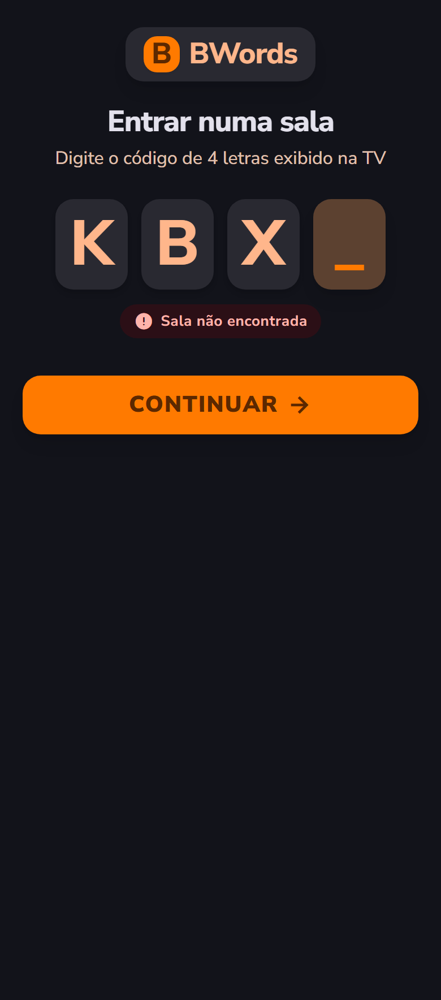 - binding - "Entrar numa sala" com as quatro caixas, o erro "Sala não encontrada" e "CONTINUAR"
- 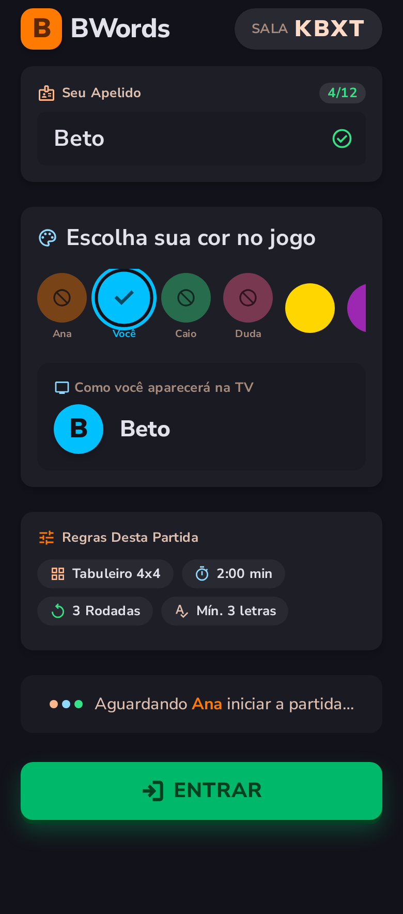 - binding - entrada do jogador: apelido, cor, prévia na TV, regras e "ENTRAR"
- 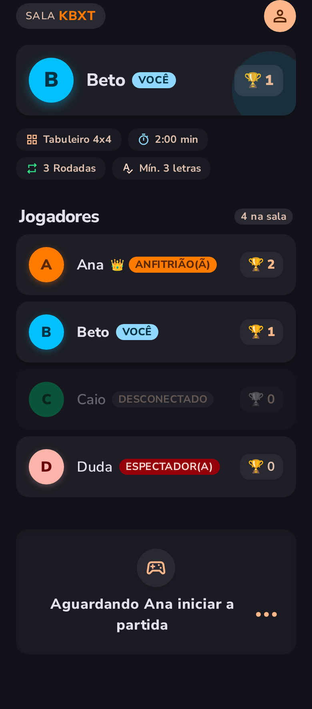 - binding - lobby do participante (Beto)
- 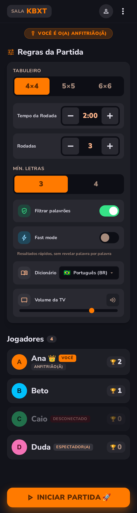 - binding - lobby do anfitrião com todas as configurações e "INICIAR PARTIDA"
- 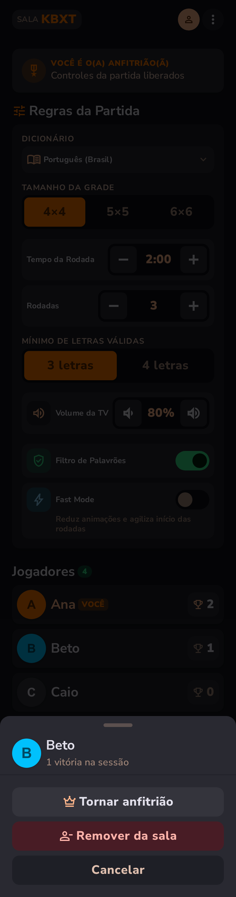 - binding - folha de ações sobre um jogador (só a folha)
-  - binding - contagem regressiva
- 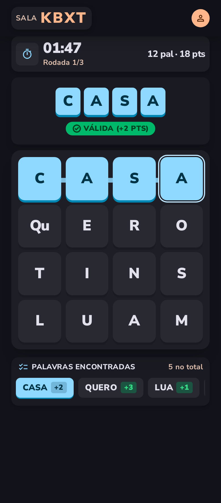 - binding - tabuleiro com o caminho aceso e o feedback "VÁLIDA (+2 PTS)"
- 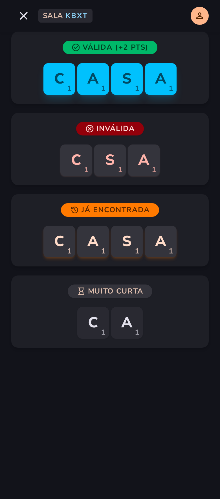 - binding - os quatro feedbacks da palavra
- 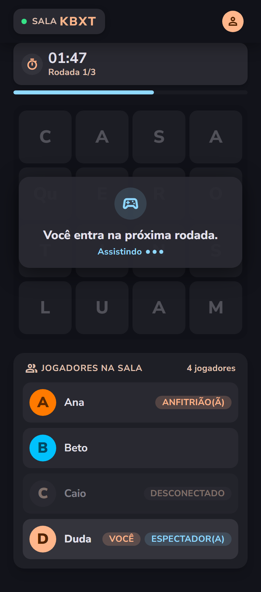 - binding - espectador na rodada
- 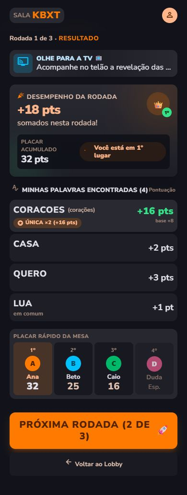 - binding - resultado da rodada visto pelo anfitrião (versão da rodada 1 do Stitch)
- 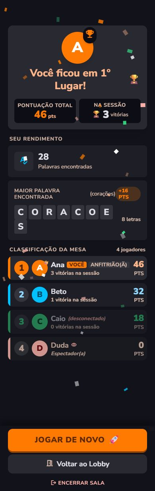 - binding - pódio visto pela anfitriã vencedora
- 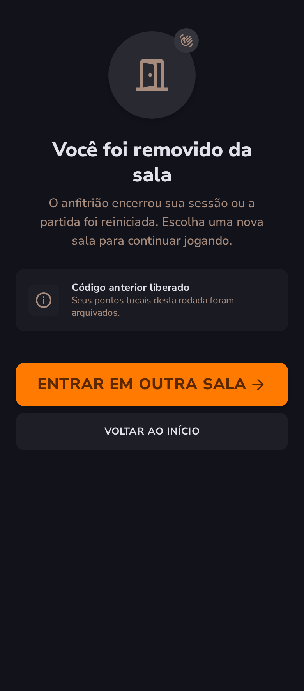 - binding - removido da sala
- 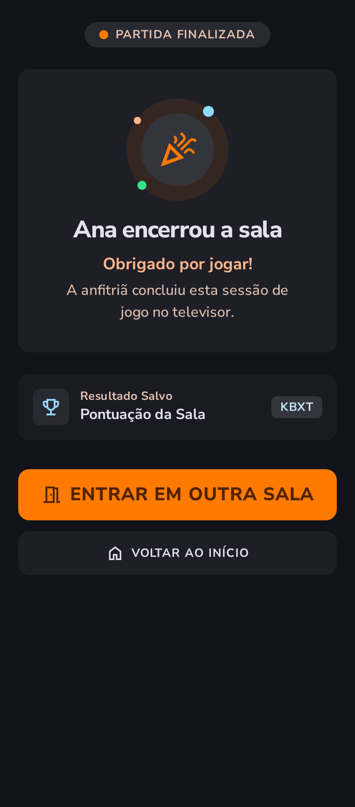 - binding - sala encerrada pelo anfitrião

---

## Success Criteria

- [ ] Um teste Playwright joga uma partida de 2 rodadas com a página de debug como TV e 3 celulares, do lobby ao "JOGAR DE NOVO"
- [ ] O feedback aparece em menos de 100 ms depois de soltar o dedo, medido no Playwright
- [ ] Cada tela com capture tem a foto `captures/<capture>.running.png` a 390 px, julgada pelo sub-agente de telas
