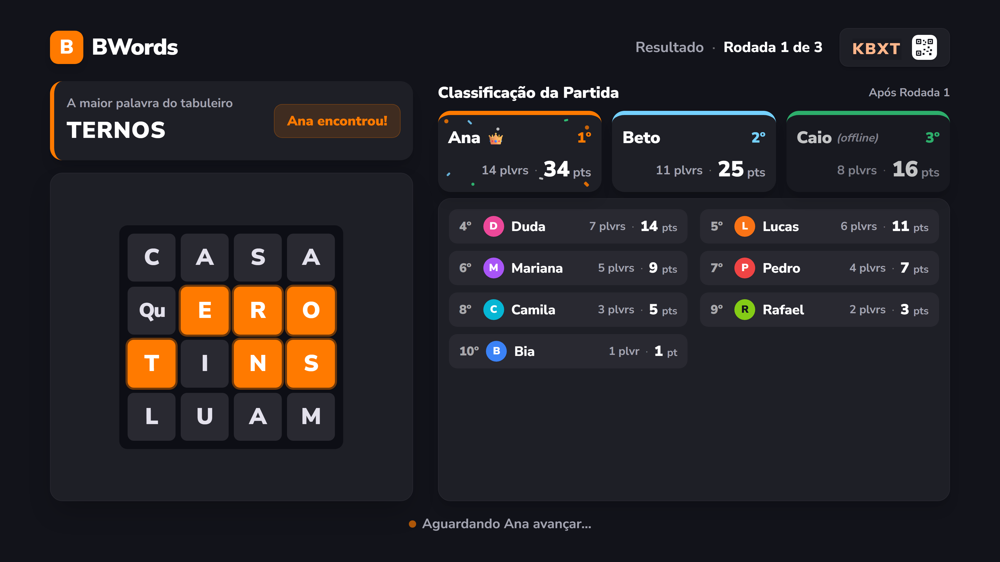

# M4.1 Playtest Specification

## Problem Statement

O primeiro teste em TV e celular reais, com o M4 publicado na Cloudflare, funcionou, mas mostrou o que atrapalha uma partida na sala de casa: a TV entra em descanso, a lista de palavras corre rápido demais e some sozinha, a sala fica em silêncio, o celular dá zoom com toques rápidos, o resultado não diz quantas palavras cada um achou e os celulares mostram o pódio antes da TV. Esta feature corrige isso e fecha as pendências deixadas pelo M4.

## Goals

- [ ] Uma TV com a página aberta e sem nenhum toque não entra em descanso durante uma partida de 3 rodadas de 3 min, conferida numa TV real
- [ ] O anfitrião conduz a lista de palavras pelo celular e decide quando a TV mostra o resultado, e uma palavra destacada por vez guia a leitura (AD-024)
- [ ] Uma música calma acompanha a partida, e uma vinheta animada toca no resultado, com a opção de desligar as duas (AD-028)
- [ ] O resultado mostra pontos e palavras de cada jogador, como em `captures/tv-round-result.png`, e abre na mesma hora na TV e nos celulares (AD-026, AD-027)
- [ ] `/` abre a TV, e a entrada por código fica em `/join` (AD-025)
- [ ] O celular não dá zoom por toque duplo nem por pinça, conferido num iPhone real

## Out of Scope

| Feature | Reason |
| --- | --- |
| Dicas de palavras | Pedido para uma próxima versão; conflita com "nenhuma palavra da rodada chega a um cliente antes do resultado" (L-008) |
| Tela cheia no celular | O user desistiu: "não, pode esquecer isso" |
| Vitória que pareceu indevida numa partida em família | O user deixou para outro momento, se voltar a acontecer |
| Escolha de outra música pelo user | O user decide depois; esta feature entrega uma música original |
| Layout próprio por modelo de TV | A solução de tela ativa não depende de modelo nem de navegador |
| Lista de palavrões e o M5 | Marco 5 |
| Domínio próprio e portfólio | Fora deste repositório; o domínio do Worker é uma mudança à parte, com pedido |
| Push e deploy | Só com pedido explícito |

---

## Assumptions & Open Questions

| Assumption / decision | Chosen default | Rationale | Confirmed? |
| --- | --- | --- | --- |
| Tela ativa | Camadas: Screen Wake Lock quando o navegador tiver; um vídeo mudo e invisível em loop; a música de fundo, quando tocar. Sem nenhuma ação que mude a tela | Nenhuma técnica funciona em todo navegador de TV | y - user: "temos que achar uma solução para inatividade, talvez tocar uma musica de fundo resolva [...] talvez programar um toque ou algum ação na tv que seja imperceptivel aos usuários" |
| Quando a tela fica ativa | Enquanto a página da TV estiver aberta, em qualquer fase, até a sala expirar | O lobby também espera gente entrar | n - default |
| Velocidade da lista | 1 palavra por segundo medida na tela: a lista sobe a altura de uma linha por segundo, sem limite de duração; uma lista que cabe no painel não se move | Achado 6 do M4: a velocidade antiga só valia para a duração | y - user: "concordo com o recomendado" |
| Controle do anfitrião | ▲ e ▼ no celular do anfitrião; o primeiro toque para a rolagem automática, e cada toque move a lista meia altura do painel | Toques curtos, sem segurar | ▲/▼ y - user: "concordo com o recomendado"; meia altura: n - default |
| "Ver resultado" | No celular do anfitrião durante toda a lista, inclusive no "Tempo!" | A TV não vai mais sozinha para o resultado | y - user: "concordo com o recomendado" |
| Fim da lista | A lista para com a última palavra inteira na tela e espera o anfitrião | Sem navegação automática | y - user: "Navegar automaticamente para a pagina de resultados não foi uma boa decisão" |
| Palavra em destaque | Uma palavra por vez fica destacada, a que passa por uma linha de leitura fixa no terço de cima do painel; com a lista subindo uma linha por segundo, o destaque troca a cada segundo e segue a ordem da lista | Guia a leitura | destaque: y - user: "Na lista de palavras, coloque o funcionamento de grifar e ou destacar uma palavra por vez enquanto a tela desce, para guiar a leitura dos usuários, junto efeito de grifar deve tocar um som de \"check\" ou \"pontuação\" valida."; linha de leitura: n - default |
| Lista que cabe no painel | O destaque desce de palavra em palavra, uma por segundo, com a lista parada, e para na última | O destaque guia a leitura mesmo sem rolagem | n - default |
| Som do destaque | Um "check" curto e sintetizado, como o de palavra válida do celular, a cada palavra destacada; é um efeito, então a opção "Música" não o desliga | Pedido do user | som: y - user: "Na lista de palavras, coloque o funcionamento de grifar e ou destacar uma palavra por vez enquanto a tela desce, para guiar a leitura dos usuários, junto efeito de grifar deve tocar um som de \"check\" ou \"pontuação\" valida."; fora da opção "Música": n - default |
| Destaque no controle manual | Quando o anfitrião toca ▲ ou ▼, o destaque e o som param, e a lista fica sem destaque até o fim | O destaque segue a leitura automática; no manual, quem conduz é o anfitrião | n - default |
| TV recarregada na lista | Volta ao topo, com a rolagem automática | A posição da lista só existe na TV | n - default |
| Celular durante a lista | Jogadores, espectadores e o anfitrião veem "Olhe para a TV"; o anfitrião vê também ▲, ▼ e "Ver resultado" | Pedido do user | y - user: "no celular pode ter uma tela intermediaria que manda apenas olhar para tv" |
| Texto da tela intermediária | "Olhe para a TV" e, abaixo, "As palavras da rodada estão passando lá" | Diz o que fazer e por quê | n - default |
| Pódio sincronizado | Na última rodada, os celulares ficam em "Olhe para a TV" até o anfitrião tocar "Ver resultado"; TV e celulares mudam juntos | Pedido do user | y - user: "Sincronize a exibição do pódio no mesmo momento entre a tv e os celulares" |
| Rodadas do meio | O resultado da rodada no celular também espera "Ver resultado", como o pódio | A mesma regra em toda rodada | n - default |
| Música de fundo | Original, calma, no estilo de jogos antigos, gerada no navegador; da primeira contagem até a lista da última rodada; continua de onde parou, sem recomeçar; em silêncio no lobby; mais baixa que os outros sons | Pedido do user | y - user: "concordo com o recomendado, depois eu decido se coloco outra musica" |
| Vinheta do resultado | Uma só, animada, de cerca de 30 s, em loop enquanto o resultado estiver na tela, em toda rodada; a música de fundo fica em silêncio no resultado | Pedido do user | y - user: "Mantenha a mesma vinheta em todas as salas, ela deve ser mais longa, pode ter 30s e ficar rodando em looping." |
| Opção "Música" | No lobby do anfitrião; ligada por padrão; desliga a música de fundo e a vinheta, e os outros sons continuam | Abaixar o volume da TV abaixaria tudo | y - user: "sim" |
| Música e áudio bloqueado | A música e a vinheta só tocam depois que o navegador libera o som, como os outros sons (TVAUDIO-01 do M4) | Regra do navegador | y - fato de plataforma |
| Resultado: valores | Entre as rodadas, pontos e palavras da rodada; no resultado da última, a soma da partida dos dois | Coerência entre pontos e palavras | y - user: "deve ser mostrados pontos e palavras por rodada, na rodada final mostrar o somatorio dos 2 valores." |
| Resultado: ordem | Entre as rodadas, pelos pontos da rodada, com "Classificação da Rodada N"; na última, pela soma da partida, com "Classificação da Partida" | Os números e as posições contam a mesma história | y - user: "Sim, pela rodada" |
| Palavras de um jogador | As únicas dele mais as em comum que ele achou | É o que ele achou | n - default |
| Formato | "14 plvrs · 34 pts", "1 plvr · 1 pt" no singular | Como no Stitch | y - user: "mantenha \"plvrs\" abreviado" |
| Cartão do código | Sem "CÓDIGO DA SALA", como no Stitch | O código e o QR já se explicam | y - user: "Pode remover o rótulo, não precisamos dele." |
| "Após Rodada N" ao lado do título | Sai, porque "Classificação da Rodada N" já diz a rodada | Repetiria a informação | n - pergunta aberta |
| Rotas | `/` e `/tv` abrem a TV; `/join` abre a entrada por código; `/<CÓDIGO>` abre o celular | O celular chega quase sempre pelo QR | y - user: "a tela de entrar com codigo pode virar \"/join\"" |
| `/join` contra um código | "JOIN" nunca é um código: o alfabeto dos códigos não tem I nem O (`ROOM_CODE_ALPHABET`) | Fato do código | y - fato do código |
| Endereço na TV | "ou acesse <host>/<CÓDIGO>" no lugar de "ou acesse <host> e digite o código" | Quem não lê o QR digita o endereço inteiro | y - user: "sim" (pergunta 7 do teste) |
| Zoom | Sem zoom por toque duplo nem por pinça em nenhuma tela do celular | Pedido do user | y - user: "Remover a possibilidade de dar zoom na tela do celular" |
| Pendências do M4 | Socket que cai antes do `welcome`, faixa "Reconectando…" abaixo do cartão do código, 4 workers no E2E do celular, "Quem entrar primeiro vira anfitrião(ã)", `wrangler.jsonc` no DESIGN | Achados do fechamento do M4 | y - user: "aceito as sugestões das 7 pendencias" |
| Retorno da palavra no celular | Já existe desde o M3 (PLAY-01 AC 6-9, 18-19): a palavra acima do tabuleiro fica verde em "VÁLIDA", amarela em "JÁ ENCONTRADA" e vermelha em "INVÁLIDA"; vibração e som só em "VÁLIDA". Esta feature muda o som e o padrão das preferências | Pedido do user; o resto já está feito | y - user: "no celular após selecionar e validar a palavra selecionada, o resultado da validação \"já encontrada\", \"válida\" e \"incorreta\" e pintar a palavra com a cor correspondente de cada efeito e ao ser uma palavra válida pode vibrar e fazer o mesmo som de \"check\" utilizado na lista de palavras. Todos os sons devem vir ativados por padrão, após o usuário configurar no celular dele, podemos manter as configurações feitas em outras sessões se possivel e ativa-las iguais assim que o usuário conectar no lobby" |
| Pintar também as peças do caminho no tabuleiro | Depende da pergunta aberta | Hoje só a palavra acima do tabuleiro muda de cor | n - pergunta aberta |
| Preferências ligadas por padrão | "Vibrar" e "Som ao acertar" começam ligadas num celular sem preferência guardada; quem já guardou uma escolha a mantém | Muda PREF-01 AC 1 do M3 | y - user: "no celular após selecionar e validar a palavra selecionada, o resultado da validação \"já encontrada\", \"válida\" e \"incorreta\" e pintar a palavra com a cor correspondente de cada efeito e ao ser uma palavra válida pode vibrar e fazer o mesmo som de \"check\" utilizado na lista de palavras. Todos os sons devem vir ativados por padrão, após o usuário configurar no celular dele, podemos manter as configurações feitas em outras sessões se possivel e ativa-las iguais assim que o usuário conectar no lobby" |
| Preferências entre sessões | Continuam no `localStorage` do navegador e valem em toda sala, como em PREF-01 AC 2 do M3; outro navegador ou aba anônima começa do padrão | Não há conta de jogador onde guardar | y - user: "no celular após selecionar e validar a palavra selecionada, o resultado da validação \"já encontrada\", \"válida\" e \"incorreta\" e pintar a palavra com a cor correspondente de cada efeito e ao ser uma palavra válida pode vibrar e fazer o mesmo som de \"check\" utilizado na lista de palavras. Todos os sons devem vir ativados por padrão, após o usuário configurar no celular dele, podemos manter as configurações feitas em outras sessões se possivel e ativa-las iguais assim que o usuário conectar no lobby" |
| Vibração no iPhone | O Safari do iPhone não tem `navigator.vibrate`, então "Vibrar" continua escondido lá (PREF-01 AC 3 do M3) | Limite da plataforma | y - fato de plataforma |
| Mudanças em testes do M3 e do M4 | Os testes da navegação automática para o resultado, do pódio direto no celular, do celular em `/`, dos pontos acumulados entre as rodadas e do texto do endereço mudam junto com os critérios novos | Os critérios mudaram; nenhum teste é apagado sem o critério que o substitui | n - default |

**Open questions:** "Após Rodada N" ao lado do título: sair (recomendado) ou ficar; pintar também as peças do caminho no tabuleiro.

---

## User Stories

### P1: Tela da TV sempre ativa ⭐ MVP

**User Story**: Como dono da TV, quero abrir a página uma vez e não mexer mais na TV, sem que ela entre em descanso.

**Why P1**: A TV real entrou em descanso no meio da partida.

**Acceptance Criteria**:

1. WHILE a página da TV está aberta e visível, the TV SHALL manter um pedido de Screen Wake Lock ativo quando o navegador oferecer a API
2. WHEN a página da TV volta a ficar visível THEN the TV SHALL pedir a Screen Wake Lock de novo
3. WHILE a página da TV está aberta, the TV SHALL tocar em loop um vídeo mudo, fora da vista dos jogadores
4. IF o navegador recusa a Screen Wake Lock ou o vídeo THEN the TV SHALL seguir o jogo sem mostrar erro
5. The TV SHALL manter a tela ativa sem mudar nada que os jogadores vejam

**Independent Test**: Abrir a TV, iniciar uma partida de 3 rodadas de 3 min sem tocar no controle e conferir, na TV real, que ela não entra em descanso.

---

### P1: Lista de palavras conduzida pelo anfitrião ⭐ MVP

**User Story**: Como anfitrião, quero rolar a lista de palavras pelo celular e decidir quando a TV mostra o resultado, para a sala ler com calma.

**Why P1**: AD-024.

**Acceptance Criteria**:

1. WHEN a lista de palavras abre THEN the TV SHALL rolá-la sozinha, subindo a altura de uma linha por segundo
2. IF a lista cabe no painel THEN the TV SHALL mantê-la parada
3. WHEN a última palavra fica inteira na tela THEN the TV SHALL parar a lista e continuar na tela de palavras
4. WHILE a TV mostra "Tempo!" ou a lista de palavras, the celular do anfitrião SHALL mostrar ▲, ▼ e "Ver resultado"
5. WHEN o anfitrião toca ▼ THEN the TV SHALL parar a rolagem automática e descer a lista meia altura do painel
6. WHEN o anfitrião toca ▲ THEN the TV SHALL parar a rolagem automática e subir a lista meia altura do painel
7. IF um toque passaria do começo ou do fim da lista THEN the TV SHALL parar no começo ou com a última palavra inteira na tela
8. WHEN o anfitrião toca "Ver resultado" THEN the TV SHALL mostrar o resultado da rodada
9. The TV SHALL mostrar o resultado só depois do toque em "Ver resultado"
10. IF quem não é o anfitrião manda rolar ou ver o resultado THEN the servidor SHALL recusar o pedido
11. WHEN a TV é recarregada durante a lista THEN the TV SHALL voltar à lista, do topo, com a rolagem automática
12. WHEN o anfitrião passa para outro jogador durante a lista THEN the celular do novo anfitrião SHALL mostrar ▲, ▼ e "Ver resultado"
13. WHILE a lista anda sozinha, the TV SHALL destacar uma palavra por vez, a que está na linha de leitura do terço de cima do painel
14. WHILE a lista cabe no painel, the TV SHALL destacar as palavras uma por vez, na ordem da lista, trocando a cada segundo, e parar na última
15. WHEN uma palavra passa a ficar destacada THEN the TV SHALL tocar um "check" curto
16. WHEN o anfitrião toca ▲ ou ▼ THEN the TV SHALL tirar o destaque e parar o "check" até o fim da lista
17. The TV SHALL destacar só com cor e escala, sem mudar a posição das outras palavras

**Independent Test**: Terminar uma rodada com uma lista longa, conferir a rolagem a uma linha por segundo, rolar com ▲ e ▼, chegar ao fim, esperar e tocar "Ver resultado".

---

### P1: Celulares sincronizados com a TV ⭐ MVP

**User Story**: Como jogador, quero olhar para a TV enquanto as palavras passam e ver o resultado no celular junto com a TV.

**Why P1**: AD-026.

**Acceptance Criteria**:

1. WHILE a TV mostra "Tempo!" ou a lista de palavras, the celular SHALL mostrar "Olhe para a TV" e "As palavras da rodada estão passando lá"
2. WHEN o anfitrião toca "Ver resultado" numa rodada que não é a última THEN the celular SHALL mostrar o resultado da rodada
3. WHEN o anfitrião toca "Ver resultado" na última rodada THEN the celular SHALL mostrar o pódio
4. The celular SHALL mostrar o pódio só depois do toque em "Ver resultado"
5. WHEN um celular conecta ou reconecta durante a lista THEN the celular SHALL mostrar "Olhe para a TV"
6. WHEN um celular conecta ou reconecta depois de "Ver resultado" THEN the celular SHALL mostrar o resultado ou o pódio

**Independent Test**: Jogar a última rodada com dois celulares e conferir que eles mostram "Olhe para a TV" até "Ver resultado" e o pódio na mesma hora que a TV.

---

### P1: Resultado com pontos e palavras ⭐ MVP

**User Story**: Como jogador, quero ver quantas palavras e quantos pontos cada um fez, e a maior palavra antes do tabuleiro.

**Why P1**: AD-027.

**Acceptance Criteria**:

1. WHEN o anfitrião toca "Ver resultado" numa rodada que não é a última THEN the TV SHALL mostrar a tela em `.specs/features/m4-1-playtest/captures/tv-round-result.png`
2. WHILE o resultado é de uma rodada que não é a última, the TV SHALL mostrar em cada cartão e em cada linha as palavras e os pontos daquela rodada, como "14 plvrs · 34 pts"
3. WHILE o resultado é da última rodada, the TV SHALL mostrar em cada cartão e em cada linha a soma das palavras e dos pontos da partida
4. The TV SHALL escrever "1 plvr" e "1 pt" no singular, e "plvrs" e "pts" nos outros casos, inclusive 0
5. The TV SHALL contar como palavras de um jogador as únicas dele e as em comum que ele achou
6. WHILE o resultado é de uma rodada que não é a última, the TV SHALL ordenar os jogadores e dar as posições pelos pontos da rodada, com o título "Classificação da Rodada N"
7. WHILE o resultado é da última rodada, the TV SHALL ordenar os jogadores e dar as posições pela soma da partida, com o título "Classificação da Partida"
8. The TV SHALL mostrar o cartão da maior palavra do tabuleiro acima do tabuleiro
9. The TV SHALL mostrar no cartão do código só o código e o QR, sem "CÓDIGO DA SALA"
10. IF um jogador entrou atrasado e não jogou a rodada THEN the TV SHALL mostrá-lo por último, com "0 plvrs · 0 pts" na rodada e a soma do que jogou no resultado da última rodada

**Independent Test**: Jogar duas rodadas em que a ordem da rodada difere da ordem da partida e conferir os números e a ordem nos dois resultados.

---

### P2: Música e vinheta

**User Story**: Como jogador, quero uma música calma durante a partida e uma vinheta animada no resultado, para a sala não ficar em silêncio.

**Why P2**: AD-028; o jogo funciona sem ela.

**Acceptance Criteria**:

1. WHILE a partida está entre a primeira contagem e o fim da lista de palavras da última rodada, the TV SHALL tocar a música de fundo
2. WHEN a música de fundo volta depois de um resultado THEN the TV SHALL continuá-la de onde parou
3. WHILE a TV mostra o lobby, the TV SHALL ficar sem música
4. WHILE a TV mostra o resultado de qualquer rodada, the TV SHALL tocar a vinheta em loop e deixar a música de fundo em silêncio
5. The TV SHALL tocar a música de fundo e a vinheta mais baixas que os outros sons
6. The TV SHALL gerar a música de fundo e a vinheta no navegador, sem arquivo de áudio
7. The vinheta SHALL ter cerca de 30 s antes de recomeçar
8. WHERE o anfitrião desliga a opção "Música" no lobby, the TV SHALL ficar sem música de fundo e sem vinheta, e tocar os outros sons
9. The opção "Música" SHALL começar ligada numa sala nova
10. IF o navegador ainda não liberou o som THEN the TV SHALL tocar a música e a vinheta só depois da liberação, a partir do ponto em que estariam

**Independent Test**: Jogar duas rodadas ouvindo a música na contagem, na rodada e na lista, a vinheta no resultado, e desligar a opção "Música" no lobby.

---

### P2: Retorno da palavra no celular

**User Story**: Como jogador, quero ouvir o mesmo "check" da TV quando acerto uma palavra, com som e vibração já ligados.

**Why P2**: Pedido do user depois do teste; o retorno por cor já existe.

**Acceptance Criteria**:

1. IF o celular não tem preferências guardadas THEN the celular SHALL começar com "Vibrar" e "Som ao acertar" ligados
2. WHERE "Som ao acertar" está ligado, WHEN o feedback é "VÁLIDA" THEN the celular SHALL tocar o mesmo "check" que a TV toca na lista de palavras
3. WHERE "Vibrar" está ligado, WHEN o feedback é "VÁLIDA" THEN the celular SHALL vibrar 50 ms
4. WHEN o jogador entra numa sala THEN the celular SHALL usar as preferências guardadas no navegador, de qualquer sala anterior
5. The celular SHALL manter a palavra acima do tabuleiro verde em "VÁLIDA", amarela em "JÁ ENCONTRADA" e vermelha em "INVÁLIDA" (PLAY-01 AC 7-9 do M3)

**Independent Test**: Num navegador limpo, entrar numa sala, acertar uma palavra e ouvir o "check" com vibração; desligar o som, entrar em outra sala e conferir que continua desligado.

---

### P1: Rotas ⭐ MVP

**User Story**: Como dono da TV, quero abrir o endereço do jogo sem caminho e cair na TV; como jogador, quero entrar pelo QR ou pelo endereço com o código.

**Why P1**: AD-025.

**Acceptance Criteria**:

1. WHEN alguém abre `/` THEN the servidor SHALL servir a TV
2. WHEN alguém abre `/tv` THEN the servidor SHALL servir a TV
3. WHEN alguém abre `/join` THEN the servidor SHALL servir a entrada por código do celular
4. WHEN alguém abre `/<CÓDIGO>` THEN the servidor SHALL servir o celular dessa sala
5. The TV SHALL mostrar "ou acesse <host>/<CÓDIGO>" no lobby
6. WHEN o celular sai de uma sala THEN the celular SHALL ir para `/join`
7. The servidor SHALL continuar sem servir o pacote de idioma (PROTO-01 AC 8)

**Independent Test**: Abrir `/`, `/tv`, `/join` e `/<CÓDIGO>` e conferir cada tela; sair de uma sala no celular e conferir `/join`.

---

### P1: Celular sem zoom ⭐ MVP

**User Story**: Como anfitrião, quero tocar rápido nos botões sem que a tela dê zoom.

**Why P1**: Aconteceu no Safari de um iPhone.

**Acceptance Criteria**:

1. WHEN o jogador toca duas vezes rápido em qualquer ponto do celular THEN the celular SHALL manter o zoom em 100%
2. WHEN o jogador faz o gesto de pinça THEN the celular SHALL manter o zoom em 100%
3. The celular SHALL responder a cada toque de um toque duplo como dois toques

**Independent Test**: No iPhone real, tocar rápido nos botões do lobby do anfitrião e fazer pinça em todas as telas.

---

### P1: Pendências do M4 ⭐ MVP

**User Story**: Como jogador, quero que as falhas pequenas vistas no fechamento do M4 saiam.

**Why P1**: Decididas pelo user no fechamento do M4.

**Acceptance Criteria**:

1. IF um socket abre e cai antes do `welcome` THEN the conexão SHALL não derrubar a conexão seguinte por causa de um prazo do socket anterior
2. WHILE a TV mostra a faixa "Reconectando…" na rodada, the TV SHALL deixar o cartão do código inteiro à vista
3. The TV SHALL mostrar "Quem entrar primeiro vira anfitrião(ã)" no lobby vazio
4. The config de E2E do celular SHALL usar 4 workers
5. The `docs/DESIGN.md` SHALL citar `wrangler.jsonc`

**Independent Test**: Derrubar um socket antes do `welcome` e conferir que a conexão seguinte segue; abrir o lobby vazio e ler o texto.

---

## Edge Cases

- IF o anfitrião toca "Ver resultado" duas vezes THEN the servidor SHALL tratar o segundo toque como recusado, sem pular o resultado
- IF o anfitrião está desconectado durante a lista THEN the TV SHALL continuar a rolagem automática até o fim e esperar o anfitrião, que volta pela passagem de anfitrião do M3
- WHEN ninguém achou nenhuma palavra THEN the TV SHALL mostrar "Nenhuma palavra encontrada" e esperar "Ver resultado"
- IF o anfitrião volta ao lobby durante a lista THEN the TV e os celulares SHALL ir para o lobby
- WHEN a opção "Música" muda no lobby THEN the TV SHALL seguir a opção na partida seguinte

---

## Requirement Traceability

| Requirement ID | Story | Phase | Status |
| --- | --- | --- | --- |
| TVAWAKE-01 | P1: Tela da TV sempre ativa (AC 1-5) | Design | Pending |
| WORDCTL-01 | P1: Lista de palavras conduzida pelo anfitrião (AC 1-17) | Design | Pending |
| SYNC-01 | P1: Celulares sincronizados com a TV (AC 1-6) | Design | Pending |
| RESULT-02 | P1: Resultado com pontos e palavras (AC 1-10) | Design | Pending |
| MUSIC-01 | P2: Música e vinheta (AC 1-10) | Design | Pending |
| FEEDBACK-02 | P2: Retorno da palavra no celular (AC 1-5) | Design | Pending |
| ROUTE-01 | P1: Rotas (AC 1-7) | Design | Pending |
| NOZOOM-01 | P1: Celular sem zoom (AC 1-3) | Design | Pending |
| M4FIX-01 | P1: Pendências do M4 (AC 1-5) | Design | Pending |

**Coverage:** 68 total, 0 mapped to tasks, 68 unmapped ⚠️

---

## Differences from the source

| Source shows | Product shows | Confirmed |
| --- | --- | --- |
| `tv-round-result.png`: "Classificação da Partida" entre as rodadas | "Classificação da Rodada N", com a ordem dos pontos da rodada | y - AD-027 |
| `tv-round-result.png`: "Após Rodada 1" | Depende da pergunta aberta | n - pergunta aberta |
| `tv-round-result.png`: "Caio (offline)" | "Caio (desconectado)" | y - AD-022 |
| `tv-round-result.png`: QR de exemplo | QR real da sala | y - AD-022 |
| `tv-round-result.png`: confete entre as rodadas | Confete só na última rodada | y - AD-024, que mantém AD-021 |
| `tv-round-result.png`: "Resultado · Rodada 1 de 3" e "Aguardando Ana avançar…" em toda rodada | Na última rodada, "<vencedor> venceu!" e "Aguardando Ana: jogar de novo ou voltar ao lobby" | y - AD-024, que mantém AD-021 |

## Sources

- `.specs/features/m4-1-playtest/context.md` - o pedido e as respostas do user, com as palavras dele
- `.specs/features/m4-tv/spec.md` - os critérios do M4 que esta feature muda: TVWORDS-01 AC 1, 6-9; TVRES-01 AC 1-3; TVLOBBY-01 AC 10; SERVE-01; PHONE-01 AC 1
- Stitch, projeto 13555119467933870727, tela "TV - Resultado da Rodada" (`8e179fbf565d4dd0bb10dfa9c5c3117d`): a capture foi renderizada do HTML da tela a 1920x1080, porque o screenshot do Stitch está desatualizado
-  - binding - resultado entre as rodadas com a maior palavra acima do tabuleiro e "plvrs · pts" em cada cartão e linha

---

## Success Criteria

- [ ] Numa partida real em família, a TV não entra em descanso e ninguém precisa tocar nela
- [ ] A sala lê a lista inteira no ritmo do anfitrião, e TV e celulares mostram o resultado na mesma hora
- [ ] Nenhum zoom acidental no iPhone durante uma partida inteira
