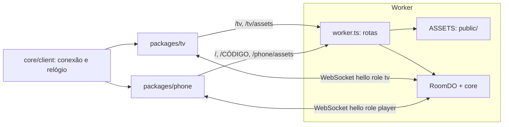
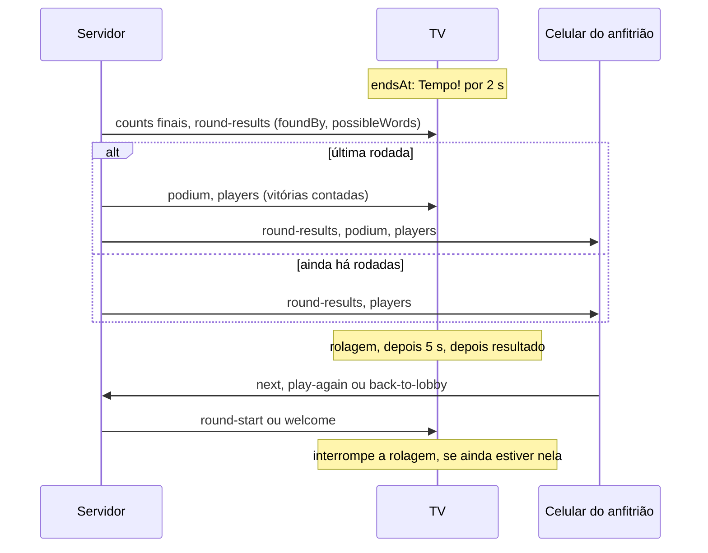

# M4 TV Design

**Spec**: `.specs/features/m4-tv/spec.md`
**Status**: Approved
**Approved**: 2026-10-30 - user: "Aprovo o design"

---

## Architecture Overview

A TV é um cliente Preact novo (`packages/tv`), com a mesma estrutura do celular (style guide §2.1). Ela só mostra o que o servidor manda. O que acontece depois do fim da rodada (Tempo!, rolagem, espera, resultado) é só da TV: é decidido por uma função pura a partir do relógio e da mensagem `round-results`, sem mensagens novas no meio do caminho.



Fluxo depois do fim da rodada:



### Três decisões de abordagem

**1. Código que TV e celular compartilham: sobe para o `core`.** A conexão (`room-connection`, `clock-sync`) e a regra de posições (`placesOf`) vão para `packages/core/src/client/`.
- É o que o style guide manda (§2: "O que dois deles precisam compartilhar sobe para o `core`"), e esses módulos já não usam DOM: socket, relógio e timers entram por injeção.
- Alternativas descartadas: um pacote `@bwords/client` novo (mais uma peça para um uso só) e copiar os arquivos (dois lugares para corrigir a reconexão).
- Custo: uma tarefa de refatoração no celular, com os testes movidos junto e nenhum enfraquecido.

**2. Uma pasta de assets gerada.** O Wrangler aceita um único diretório de assets, hoje o do dicionário. Um script novo (`npm run assets:build`) monta `packages/server/public/` (git-ignored) com `pt-BR/`, `phone/` e `tv/`. O Worker continua com `run_worker_first` e passa a servir uma lista fechada de caminhos; todo o resto, inclusive `/pt-BR/*`, responde 404.
- Alternativa descartada: gerar os clientes dentro de `tools/dict-build/dist/`, que mistura saídas de ferramentas sem relação.

**3. Etapas pós-rodada em função pura, sem timers acumulados.** `revealStage(now, plan)` responde em qual etapa a TV está a partir do instante atual. Assim, recarregar, reconectar ou testar com relógio falso não dependem de uma cadeia de `setTimeout`, e a regra fica em `model/`, ao alcance do Vitest.

---

## Code Reuse Analysis

### Existing Components to Leverage

| Component | Location | How to Use |
| --- | --- | --- |
| Conexão, reconexão e relógio | `packages/phone/src/net/room-connection.ts`, `clock-sync.ts` | Movem para `core/src/client/`; o celular e a TV importam de `@bwords/core` |
| Adaptador do WebSocket | `packages/phone/src/net/browser.ts` | Padrão copiado na TV (é a ponta com DOM, não sobe para o `core`) |
| Redutor da sala | `packages/phone/src/model/room-view.ts` | Padrão para `tv/model/room-view.ts`, menor: sem `found`, `salt` nem hashes |
| Posições com empate | `placesOf` em `packages/phone/src/model/players.ts` | Sobe para `core/src/client/places.ts` |
| Coroa | `crownedPlayers` (`core/room/wins.ts`) | Direto |
| Caminho das palavras | `findPath`; `longest.path` já vem em `round-results` | A TV usa `longest.path` para acender as peças |
| Regra de iniciais e contraste | `packages/phone/src/model/colors.ts`, `components/PlayerAvatar.tsx` | Padrão para o círculo da TV |
| Fonte, tema e eslint | `@fontsource/nunito-sans`, `@bwords/theme`, `packages/phone/eslint.config.js` | Mesma configuração |
| Sala simulada e fotos | `packages/phone/e2e/fake-room.ts`, `playwright.pictures.config.ts` | Padrão para as fotos da TV, com `CAPTURE_WINDOWS` de 1920x1080 |
| Jogadores em Node nos E2E | `packages/phone/e2e/tv.ts` (`joinPlayer`) | Padrão para os celulares nos E2E da TV |
| Fim da rodada | `endRound` em `core/room/results.ts` | Ganha os campos novos e a passagem para o pódio |
| Prova do dicionário | `packages/server/e2e/assets.test.ts` | Ganha as rotas novas |

### Integration Points

| System | Integration Method |
| --- | --- |
| Protocolo | `hello` com `role: 'tv'` e o `tvToken` de `POST /api/rooms`; os campos novos entram em `round-results` |
| Celular | Só muda em `screen.ts`, `ResultHostActions`, `SettingsPanel` e nas strings; o redutor já trata `round-results` e `podium` |
| Debug (`tools/debug`) | Perde o campo `fastMode` e passa a mostrar o pódio logo depois da última rodada |

---

## Components

### Core: resultado e fluxo

- **Purpose**: Mandar os dados da página de palavras e encerrar a partida sem `next`.
- **Location**: `packages/core/src/room/results.ts`, `flow.ts`, `machine.ts`, `protocol.ts`
- **Interfaces**:
  - `endRound(state, now, deps): StepResult` - em `shared`, cada palavra traz `foundBy`; a mensagem traz `possibleWords`. Na última rodada, a fase vira `podium`, as vitórias são contadas e os efeitos são `round-results`, `podium`, `players`.
  - `afterWelcome(state, to)` - no `podium` com `state.results`, manda `round-results` e depois `podium`; num `podium` sem `results`, só `podium`.
  - `PHASES_OF.next` continua `['results']`, então `next` no pódio responde `wrong-phase`.
- **Reuses**: `awardWins` e `podiumMessage`, de `flow.ts`.

### Core: sem fast mode

- **Purpose**: Tirar `fastMode` de `Settings` e da validação.
- **Location**: `packages/core/src/room/protocol.ts`, `settings.ts`, `state.ts`
- **Interfaces**: `validateSettingsPatch` recusa `fastMode` com `bad-settings`, como qualquer chave desconhecida. `sanitizeLoadedSettings(raw)` tira o campo de uma sala já guardada.

### Core: cliente compartilhado

- **Purpose**: A conexão e as posições, usadas pelos dois clientes.
- **Location**: `packages/core/src/client/` (`room-connection.ts`, `clock-sync.ts`, `places.ts`)
- **Interfaces**: as atuais. `onHashes` fica opcional, porque a TV não recebe hashes. A T11 acrescenta a escolha do `hello` (emenda de 2026-10-30, retorno da fase 1): o celular manda `role: player`, com token opcional, e a TV manda `role: tv`, com token obrigatório.
- **Dependencies**: nenhuma de DOM; `openSocket`, `now` e `schedule` continuam injetados.

### Worker e assets

- **Purpose**: Servir TV e celular sem expor o dicionário.
- **Location**: `packages/server/src/worker.ts`, `packages/server/src/client-routes.ts`, `tools/assets-build/`
- **Interfaces**:
  - `clientAsset(pathname): string | null` - função pura e testada: `/tv` e `/tv/` dão a TV; `/` e `/<CÓDIGO>` dão o celular; `/tv/assets/*` e `/phone/assets/*` passam; o resto dá `null`, que vira 404.
  - `npm run assets:build` - gera o pacote, os dois clientes e monta `packages/server/public/`.
- **Reuses**: `isRoomCode`.

### TV: `net/` e `state/`

- **Purpose**: Ligar a conexão ao estado em signals.
- **Location**: `packages/tv/src/net/browser.ts`, `state/room.ts`, `state/store.ts`, `state/token-store.ts`, `state/reveal.ts`, `state/server-clock.ts`
- **Interfaces**:
  - `createRoomStore(deps)` - `room` (signal de `RoomView`), `status`, `open()`, que aplica TVROOM-01 (token guardado ou sala nova) e TVEXIT-01.
  - `createRevealClock(deps)` - guarda o instante em que chegou o `round-results` e expõe o `computed` da etapa.
- **Dependencies**: `fetch`, `localStorage`, `WebSocket` e relógio injetados (style guide §4, D).

### TV: `model/` (regras puras, Vitest)

| Módulo | Função | Requisito |
| --- | --- | --- |
| `room-view.ts` | `applyServerMessage(view, msg, now)` | TVROOM-01, TVEXIT-01 |
| `screen.ts` | `tvScreen(view, status, stage, serverNow)`: tabela fase → tela | Todas as telas |
| `reveal.ts` | `scrollDurationMs(rowCount)`, `revealStage(now, plan)` | TVPLAY-01 AC 10, TVWORDS-01 AC 6-9 |
| `word-rows.ts` | `wordRows(results, players)`: linhas e títulos na ordem | TVWORDS-01 AC 3-5 |
| `standings.ts` | `standings(players)`: `top` (até 3) e `rest`, com posições | TVRES-01 AC 2-3 |
| `result-header.ts` | `resultHeader(results, standings, hostName)`: título, rodapé e confete | TVRES-01 AC 8-10 |
| `lit-tiles.ts` | `litTiles(path, elapsedMs)`: peças acesas | TVRES-01 AC 5 |
| `round-columns.ts` | `roundColumns(players, counts)`: duas colunas, sem espectadores | TVPLAY-01 AC 7, 9 |
| `lobby-rows.ts` | `lobbySlots(players)`: jogadores e vagas até 10 | TVLOBBY-01 AC 4-7 |
| `clock.ts` | `formatClock`, `isAlert`, `countdownNumber` | TVPLAY-01 AC 1, 3, 4 |
| `settings-chips.ts` | `settingsChips(settings)`, `changedChip(a, b)` | TVLOBBY-01 AC 8 |
| `qr.ts` | `qrMatrix(url)`, sobre `qrcode-generator`, correção H | TVLOBBY-01 AC 2 |
| `audio-cues.ts` | `cuesBetween(before, after)`: efeitos a tocar | TVAUDIO-01 AC 1 |
| `messages.ts` | erros e motivos → chaves da tabela | Style guide §8 |

### TV: `screens/` e `components/`

- **Purpose**: Uma tela por arquivo; só leem o store e repassam dados.
- **Location**: `packages/tv/src/screens/` (`LobbyScreen`, `CountdownScreen`, `RoundScreen`, `WordsScreen`, `ResultScreen`, `ExpiredScreen`, `ReplacedScreen`, `OpeningScreen`), `components/` (`BrandHeader`, `RoomCard`, `QrCode`, `PlayerCircle`, `BoardGrid`, `TimeUpOverlay`, `ConnectionBanner`, `AudioNotice`, `WordRow`, `PodiumCard`, `Confetti`)
- **Reuses**: a tabela fase → tela de `app.tsx`, como no celular.

### TV: `device/audio.ts`

- **Purpose**: Tocar os efeitos com Web Audio, sem arquivos.
- **Interfaces**: `createAudio(factory)`: `play(cue, volume, muted)`, `isBlocked()`, `unlock()`. Sem `AudioContext`, tudo vira nada (TVAUDIO-01 AC 5).
- **Cues**: `round-start`, `last-seconds`, `time-up` (apito: oscilador agudo com vibrato, cerca de 0,6 s; TVAUDIO-01 AC 6) e `words-start`.

### Celular

- **Purpose**: Seguir o fluxo novo e perder o fast mode.
- **Location**: `packages/phone/src/components/ResultHostActions.tsx`, `SettingsPanel.tsx`, `model/settings.ts`, `strings/pt-BR.ts`
- **Interfaces**: o botão de `ResultHostActions` sempre manda `next`, porque a tela só existe quando há mais rodadas. O pódio já soma o resumo com `round-results`, que continua chegando antes do `podium`.

---

## Data Models

```typescript
/** Palavra em comum: quem a achou, só depois da rodada (PROTO-02 AC 1). */
interface SharedWord extends ResultWord {
  foundBy: string[];
}

interface RoundResultsMessage {
  type: 'round-results';
  index: number;
  shared: SharedWord[];
  players: PlayerResult[];
  longest: LongestResult | null;
  /** Soluções válidas da rodada, com o mínimo de letras e o filtro da sala (PROTO-02 AC 2). */
  possibleWords: number;
  last: boolean;
}

/** Só da TV: em que etapa ela está depois do fim da rodada. */
type RevealStage = 'time-up' | 'words' | 'hold' | 'result';

interface RevealPlan {
  /** Início da rolagem: `max(chegada do resultado, endsAt + TIME_UP_MS)`. */
  wordsStartAt: number;
  scrollMs: number;
}

type WordRow =
  | { kind: 'title'; group: 'shared' | 'unique' }
  | { kind: 'word'; word: string; spellings: readonly string[]; finders: readonly PlayerInfo[]; points: number };
```

Constantes de regra, em `model/reveal.ts`: `TIME_UP_MS = 2_000`, `WORDS_PER_SECOND = 2`, `MAX_SCROLL_MS = 60_000`, `HOLD_AFTER_LAST_MS = 5_000`. Em `model/lit-tiles.ts`: `TILE_LIGHT_MS = 400`.

**TV escalada por `rem`:** o `font-size` da raiz é `min(100vw / 120, 100vh / 67.5)`, que dá 16 px em 1920x1080 e 10,67 px em 1280x720. Todo tamanho do layout é escrito em `rem`, e a tela inteira encolhe junto, na mesma composição (AD-016).

---

## Error Handling Strategy

| Error Scenario | Handling | User Impact |
| --- | --- | --- |
| `POST /api/rooms` falha | Tenta de novo a cada 5 s | "Não foi possível abrir a sala" |
| Token recusado (`bad-token`) ou `room-not-found` | Apaga o token e cria sala | Lobby de uma sala nova |
| Socket cai | `RECONNECT_DELAYS_MS`, como no celular | Faixa "Reconectando…"; o timer segue |
| 30 s sem reconectar | Continua tentando | Faixa "Sem conexão" |
| `closed` com `closed-by-host` | Apaga o token e cria sala | Lobby de uma sala nova |
| `closed` com `idle` ou `tv-gone` | Apaga o token e espera tecla ou clique | "Sala expirada" |
| `closed` com `replaced` | Para de reconectar | "A TV foi aberta em outra aba" |
| `localStorage` lança exceção | Segue sem guardar o token | A TV funciona; recarregar abre sala nova |
| Navegador sem Web Audio | `createAudio` vira nada | Sem som e sem aviso |
| Navegador bloqueia o som | Tenta de novo na primeira tecla ou clique | Aviso no lobby |

---

## Risks & Concerns

| Concern | Location (file:line) | Impact | Mitigation |
| --- | --- | --- | --- |
| O asset binding pode redirecionar `/tv/index.html` para `/tv/`, por causa do `html_handling` padrão | `packages/server/wrangler.jsonc:8` | A TV não abre pelo Worker | Não confirmei esse comportamento na documentação. T de `clientAsset` prova com E2E em `wrangler dev`; se redirecionar, a rota pede `/tv/` |
| Mudar o diretório de assets pode quebrar `npm run debug`, `npm run dev -w @bwords/server` e o teste real de assets | `packages/server/wrangler.jsonc:8`, `packages/server/e2e/assets.test.ts` | O servidor sobe sem o dicionário | O `dev` do servidor roda o passo do pacote antes do `wrangler dev`; os testes do workerd seguem com o pacote de fixture |
| Mudar `endRound` afeta testes do M2 e do M3 que esperam `next` na última rodada | `packages/core/src/room/flow.ts:27`, `packages/phone/e2e/podium.spec.ts`, `full-match.spec.ts` | Testes vermelhos | Mudam junto com a tarefa, pelo critério novo (Assumptions do spec); ficam listados no commit |
| `handleNext` mantém um ramo que nunca mais roda | `packages/core/src/room/flow.ts:27-38` | Código morto | Sai na mesma tarefa |
| A sala guardada no storage ainda pode ter `fastMode` | `packages/server/src/storage.ts` | Campo sobrando | `sanitizeLoadedSettings` (FAST-01 AC 4), com teste |
| TV-alvo roda navegadores antigos; `min()` e `rem` podem faltar em alguns, e `qrcode-generator` não testei neles | DESIGN §4.5 | Layout errado numa TV antiga | Teste em TV real está fora do M4; fica para o M5. O M4 prova em Chromium |
| Tailwind e CDN nos HTMLs do Stitch | `captures/` | Copiar o HTML traria dependências externas | A implementação não copia o HTML: é Preact com CSS próprio |
| Rolagem longa com muitas palavras | `WordsScreen` | Trancos numa TV fraca | Animação só com `transform`, numa camada só; a lista é montada uma vez |
| A lista de palavrões está vazia | `languages/pt-BR/profanity.txt` | O filtro não filtra | Marco 5 |

---

## Tech Decisions

| Decision | Choice | Rationale |
| --- | --- | --- |
| Gerar o QR | `qrcode-generator`, versão fixada, sem dependências | Pequeno, funciona no navegador e devolve a matriz, que a TV desenha em SVG com o "B" no centro |
| Provar o QR | `jsqr` como devDependency, decodificando a foto no E2E | É a prova de "legível mesmo com o B" (TVLOBBY-01 AC 2) |
| Porta da TV em dev | 5176 | 5173 a 5175 já estão em uso; entra no `CLAUDE.md` |
| Rolagem | Uma transição de `transform`, com duração de `scrollDurationMs` | Só uma animação; o tempo fica na função pura |
| Telas a 1280x720 | Escala por `rem` na raiz | Mesma composição nas duas pontas, sem media queries |
| E2E da TV | Playwright em 1920x1080, TV real no navegador, celulares como jogadores em Node | Foco na TV; o celular já tem os próprios E2E |
| Partida inteira | Um E2E com a TV e 3 celulares reais, contra o Worker servindo os dois clientes | É o critério de sucesso do spec e prova `SERVE-01` junto |
| Docs | `DESIGN.md` e `screens.md` são atualizados no fim, pelas decisões AD-019 a AD-022 | Mantém os documentos de referência certos |
