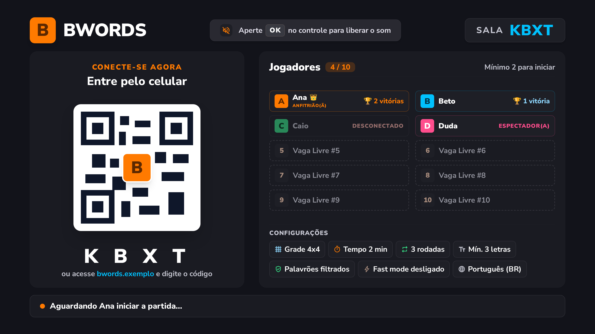
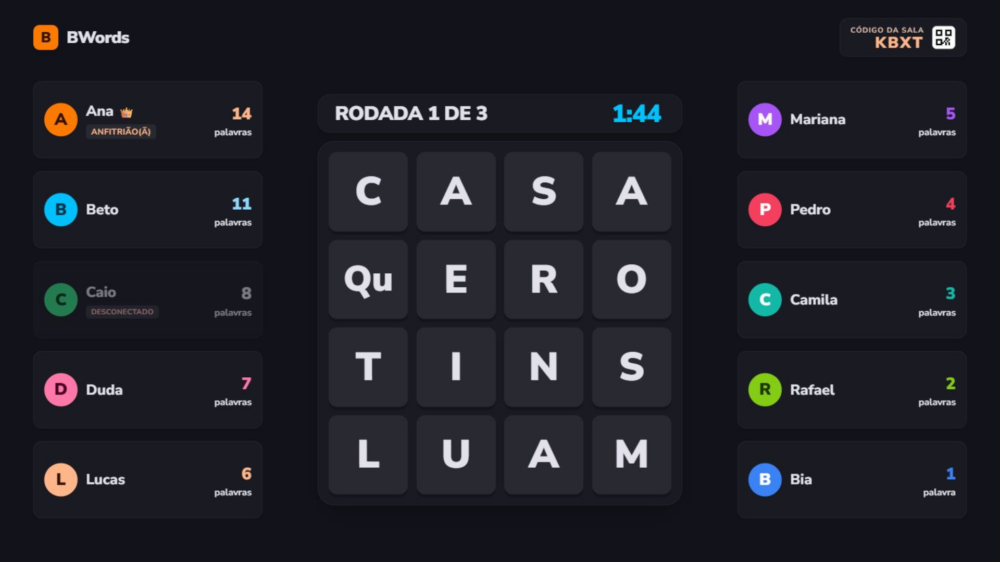
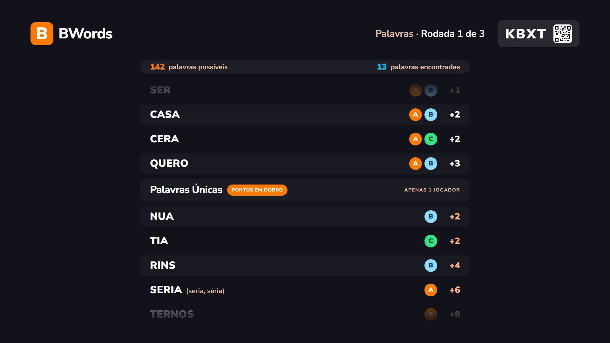
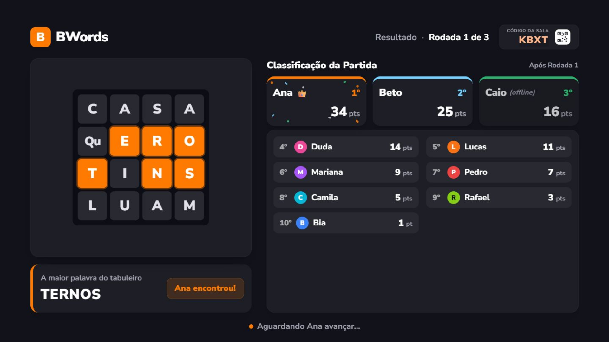

# M4 TV Specification

**Approved**: 2026-10-30 - user: "Aprovo o spec"

**Amended**: 2026-10-30 - TVEXIT-01 AC 6, 8 e 9: espera progressiva e limite de tentativas; user: "no t30 bote um limite para tentaivas para que a tv nao fique tentando muito tempo, pode ter um tempo progressivo de espera a cada tentativa"

**Amended**: 2026-10-30 - TVAUDIO-01 AC 6: som de apito em "Tempo!"; user: "nessa etapa podemos ter um som de apito na tv ou de despertador sintetico"

## Problem Statement

O celular já joga uma partida inteira, mas a TV ainda é a página de debug: não há QR para entrar, nem tabuleiro grande, nem a revelação das palavras, nem pódio. Além disso, nem o celular nem a TV são servidos pelo Worker, o que impede o teste em aparelhos de verdade. O M4 entrega a tela principal do jogo e deixa o jogo inteiro servido por um único endereço.

## Goals

- [ ] Uma TV abre `/tv`, mostra o QR e conduz uma partida inteira até o pódio, sem nenhum botão na tela, contra o servidor real (`wrangler dev`)
- [ ] Ao fim de cada rodada, a TV passa sozinha pela lista de palavras e chega ao resultado, que espera o anfitrião (AD-021)
- [ ] Cada tela com capture é fotografada a 1920x1080 e julgada contra ela, e funciona de 1280x720 a 1920x1080 sem rolagem (AD-016)
- [ ] `/tv` e o celular saem do mesmo Worker, e o dicionário continua inacessível por HTTP (PROTO-01 AC 8)
- [ ] O fast mode sai do jogo inteiro (AD-020)

## Out of Scope

| Feature | Reason |
| --- | --- |
| Deploy em produção e CI | Marco 5; o deploy só acontece com pedido do user. A prova do M4 é em `wrangler dev` |
| Teste em TV real e em celular real | Depois do M4, com o deploy |
| Lista de palavrões e filtro no gerador | Marco 5; `languages/pt-BR/profanity.txt` está vazio |
| Orçamento de desempenho na TV | Marco 5 |
| Música | DESIGN §4.4: sem música no MVP |
| Revelação em quatro etapas, com placar animado subindo | AD-021: lista em rolagem e depois resultado |
| Faixa de vitórias no resultado | Pedido do user: o resultado mostra "apenas o podio"; as vitórias ficam no lobby |
| Grupo "Assistindo" na tela da rodada | Pedido do user; a lista traz só quem joga a rodada |
| Interação na tela da TV além do "OK" | A TV não tem botões nem cursor (DESIGN §2); o "OK" só libera o som e abre sala nova |
| Layout próprio para telas fora de 16:9 | A TV-alvo é 16:9 (DESIGN §4.5); outras proporções só ocupam o espaço |
| Novas rodadas no Stitch | AD-022 |
| Push para o GitHub | Só com pedido explícito |

---

## Assumptions & Open Questions

| Assumption / decision | Chosen default | Rationale | Confirmed? |
| --- | --- | --- | --- |
| Telas de base | Captures de AD-022; o que diverge está em `## Differences from the source` | O Stitch não converge (AD-012) | y - user: "Sim, escrever spec" |
| Fluxo do resultado | Palavras, 5 s de espera, resultado que espera o anfitrião | AD-021 | y - user: pedido em AD-021 |
| Várias rodadas | Mesmo fluxo em toda rodada; entre as rodadas o resultado mostra o placar acumulado e o anfitrião tem "Próxima rodada"; só a última mostra o vencedor | Mantém a opção de rodadas | y - user: "Aceito mas não gere o prompt ainda" |
| Celular na última rodada | Vai direto para o pódio; "VER PÓDIO" deixa de existir, e a lista de palavras da última rodada não aparece no celular | Evita um toque a mais do anfitrião | y - user: "Aceito mas não gere o prompt ainda" |
| Textos de enfeite | Saem, como no AD-005 | Sem dado por trás | y - user: "Aceito mas não gere o prompt ainda" |
| Áudio | Efeitos sintetizados com Web Audio, sem arquivos | Sem licenças nem download | y - user: "Aceito mas não gere o prompt ainda" |
| Fim da sala | Encerrada pelo anfitrião abre sala nova sozinha; expirada espera "OK" ou recarga; outra aba só avisa | Evita criar salas sem ninguém olhando | y - user: "Aceito mas não gere o prompt ainda" |
| Servir o jogo | O Worker serve TV e celular já no M4; o deploy só com pedido | Destrava o teste em aparelhos | y - user: "Aceito mas não gere o prompt ainda" |
| Palavras possíveis | Todas as válidas da rodada, com o mínimo de letras e o filtro da sala, sem separar as comuns | É o que o jogo aceita; a média é de 369 num 4x4 | y - user: "Sim, escrever spec" |
| Velocidade da rolagem | 2 palavras por segundo, acelerando para durar no máximo 60 s | Listas longas não prendem a sala | y - user: "Aceito mas não gere o prompt ainda" |
| Tempo! | 2 s antes da página de palavras | Marca o fim da rodada | y - user: "Aceito mas não gere o prompt ainda" |
| Botão do anfitrião durante a rolagem | Continua ativo; apertar interrompe a rolagem | O servidor não conhece o tempo da rolagem | y - user: "Aceito mas não gere o prompt ainda" |
| TV recarregada na rolagem | A rolagem recomeça do início | Sem estado guardado | y - user: "Aceito mas não gere o prompt ainda" |
| Animação da palavra mais longa | Peças acendem uma por vez, a cada 400 ms, sem linha | User pediu letra por letra; o intervalo é um default | y - user: "a ordem pode ser marcada com animação na hora de exibir, vai acendendo letra por letra." |
| Contagem na TV | Números 3, 2, 1, um por segundo; o tabuleiro aparece no `startsAt`, sem um quadro "Já!" à parte | O mesmo que o celular; o tabuleiro não pode atrasar | y - user: "Aprovo o spec" |
| Som da revelação | Um efeito ao começar a rolagem, não um por palavra | Com muitas palavras, um por palavra cansa | y - user: "Aprovo o spec" |
| Som de "Tempo!" | Apito, no lugar do despertador | O user aceitou os dois; o apito é curto e combina com o fim de jogo | y - user: "nessa etapa podemos ter um som de apito na tv ou de despertador sintetico" |
| Efeito nos últimos 10 s | Um efeito ao chegar a 10 s | DESIGN §4.4 | y - user: "Aprovo o spec" |
| Limite de reconexão | Espera dobrando até 60 s e parada em 10 min, depois "OK" para tentar de novo | 10 min é o padrão de `TV_DISCONNECT_TIMEOUT_MIN`: depois disso a sala já expirou | y - user: "no t30 bote um limite para tentaivas para que a tv nao fique tentando muito tempo, pode ter um tempo progressivo de espera a cada tentativa" |
| Sem conexão | Depois de 30 s sem reconectar, a faixa vira "Sem conexão", e a TV continua tentando | Mesmo prazo do celular; a TV não tem botão | y - user: "Aprovo o spec" |
| Sala não criada | Sem conseguir criar sala, a TV mostra "Não foi possível abrir a sala" e tenta de novo a cada 5 s | A TV não tem botão | y - user: "Aprovo o spec" |
| Poucos jogadores na rodada | As linhas ficam na coluna da esquerda até 5 jogadores; do 6º em diante vão para a direita | Mantém a tela da capture | y - user: "Aprovo o spec" |
| Mudança de configuração no lobby | O chip alterado pulsa uma vez | `docs/screens.md` §1 | y - user: "Aprovo o spec" |
| Empate no resultado | Posições repartidas, como no celular; quem entrou atrasado vai por último, com os pontos | Mesma regra do M3 | y - user: "Aprovo o spec" |
| Título no empate | Na última rodada empatada, "Empate!" no lugar de "<vencedor> venceu!" | O título não pode nomear um só vencedor; no empate, todos vencem (DESIGN §2) | y - user: "Aprovo o spec" |
| Mudanças nos testes do M3 | Os testes de "VER PÓDIO", do resultado na última rodada e do fast mode mudam junto com os critérios novos deste spec | Os critérios mudaram; nenhum teste é apagado sem o critério que o substitui | y - user: "Aprovo o spec" |
| Endereço no QR | `<origem>/<CÓDIGO>`, a origem onde a TV está aberta | O celular já abre `/<CÓDIGO>` (M3) | y - user: "Aceito mas não gere o prompt ainda" |
| Token da TV | Guardado no `localStorage`; nunca na URL | CLAUDE.md | y - user: "Aceito mas não gere o prompt ainda" |

**Open questions:** none - todas resolvidas na aprovação.

---

## User Stories

### P1: Abrir a sala ⭐ MVP

**User Story**: Como dono da TV, quero abrir um endereço e ter a sala pronta, sem usar o controle remoto.

**Why P1**: É a entrada do jogo (DESIGN §2).

**Acceptance Criteria**:

1. WHEN a TV abre `/tv` sem token guardado THEN a TV SHALL criar uma sala e mostrar o lobby dessa sala
2. WHEN a TV abre `/tv` com o token de uma sala que ainda existe THEN a TV SHALL voltar a essa sala, na fase em que ela está
3. IF o token guardado é recusado ou a sala não existe mais THEN a TV SHALL apagar o token e criar uma sala nova
4. The TV SHALL enviar o token só na mensagem `hello`, nunca na URL
5. IF a criação da sala falha THEN a TV SHALL mostrar "Não foi possível abrir a sala" e tentar de novo a cada 5 s

**Independent Test**: Abrir `/tv`, recarregar a página e conferir que a sala é a mesma.

---

### P1: Lobby ⭐ MVP

**User Story**: Como jogador, quero ver como entrar e quem já está na sala.

**Why P1**: DESIGN §4.1.

**Acceptance Criteria**:

1. WHILE a sala está no lobby, the TV SHALL mostrar a tela em `.specs/features/m4-tv/captures/tv-lobby.png`
2. The TV SHALL gerar o QR do lobby com o endereço `<origem>/<CÓDIGO>`, legível por um leitor de QR mesmo com o "B" no centro
3. The TV SHALL mostrar o código da sala em letras grandes e o texto "ou acesse <endereço> e digite o código", com o endereço real
4. WHEN um jogador entra THEN a TV SHALL mostrar a linha dele, com a cor, o apelido e as vitórias, e atualizar o contador "N / 10"
5. WHILE um jogador está desconectado, the TV SHALL mostrar a linha dele esmaecida, com "DESCONECTADO"
6. The TV SHALL mostrar "ANFITRIÃO(Ã)" na linha do anfitrião e a coroa em quem tem mais vitórias, todos no empate
7. The TV SHALL completar a lista com as linhas "Vaga Livre #N" até 10
8. WHEN o anfitrião muda uma configuração THEN a TV SHALL mostrar o valor novo no chip e fazê-lo pulsar uma vez
9. The TV SHALL mostrar o rodapé "Aguardando <anfitrião> iniciar a partida…"
10. WHILE ninguém entrou, the TV SHALL mostrar "Ninguém entrou ainda", "0 / 10", as 10 vagas e o rodapé "O primeiro a entrar vira anfitrião(ã)"

**Independent Test**: Abrir a TV, entrar com dois celulares, mudar as configurações e conferir o espelho na TV.

---

### P1: Contagem e rodada ⭐ MVP

**User Story**: Como jogador, quero ver o tabuleiro grande e a disputa, sem revelar as palavras.

**Why P1**: DESIGN §4.2.

**Acceptance Criteria**:

1. WHILE falta tempo para o `startsAt`, the TV SHALL mostrar "RODADA N DE M", o número da contagem em tamanho gigante e nenhuma letra do tabuleiro
2. WHEN chega o `startsAt` THEN a TV SHALL mostrar a tela em `.specs/features/m4-tv/captures/tv-round.png`
3. The TV SHALL mostrar o tempo restante em "M:SS", contado a partir do relógio do servidor
4. WHILE restam 10 s ou menos, the TV SHALL mostrar o timer na cor de alerta, pulsando
5. WHEN chega uma mensagem `counts` THEN a TV SHALL atualizar o número de palavras de cada jogador, sem mostrar quais são
6. The TV SHALL mostrar "1 palavra" no singular e "N palavras" no plural
7. The TV SHALL listar só os jogadores da rodada, sem os espectadores
8. WHILE um jogador está desconectado, the TV SHALL mostrar a linha dele esmaecida, com "DESCONECTADO"
9. The TV SHALL listar até 5 jogadores na coluna da esquerda e do 6º ao 10º na da direita
10. WHEN chega o `endsAt` THEN a TV SHALL mostrar "0:00", o tabuleiro esmaecido e "Tempo!" sobre ele, por 2 s
11. The TV SHALL mostrar o tabuleiro 5x5 e 6x6 no mesmo quadrado, com peças menores

**Independent Test**: Jogar uma rodada e conferir que os números sobem na TV, sem nenhuma palavra.

---

### P1: Palavras da rodada ⭐ MVP

**User Story**: Como jogador, quero ver todas as palavras encontradas e quem achou cada uma.

**Why P1**: AD-021.

**Acceptance Criteria**:

1. WHEN os 2 s de "Tempo!" terminam THEN a TV SHALL mostrar a tela em `.specs/features/m4-tv/captures/tv-words.png` e começar a rolagem sozinha
2. The TV SHALL mostrar o total de palavras possíveis da rodada e o total de palavras encontradas, numa faixa que não rola
3. The TV SHALL listar primeiro as palavras em comum, sob "Palavras em comum", e depois as únicas, sob "Palavras Únicas" com "pontos em dobro"
4. The TV SHALL ordenar cada grupo da menor palavra para a maior e, no mesmo tamanho, em ordem alfabética
5. The TV SHALL mostrar em cada linha a palavra em maiúsculas sem acento, as grafias reais quando existirem, um círculo na cor de cada jogador que a achou, com a inicial, e os pontos
6. The TV SHALL rolar a lista a 2 palavras por segundo
7. IF a lista levaria mais de 60 s nessa velocidade THEN a TV SHALL acelerar a rolagem para terminar em 60 s
8. WHEN a última palavra aparece inteira THEN a TV SHALL esperar 5 s e mostrar o resultado
9. IF ninguém achou nenhuma palavra THEN a TV SHALL mostrar "Nenhuma palavra encontrada" por 5 s e depois o resultado
10. WHEN o anfitrião avança, joga de novo ou volta ao lobby durante a rolagem THEN a TV SHALL interromper a rolagem e seguir o servidor
11. WHEN a TV é recarregada durante a rolagem THEN a TV SHALL recomeçar a rolagem do início

**Independent Test**: Terminar uma rodada com palavras em comum e únicas e conferir a ordem e os círculos.

---

### P1: Resultado ⭐ MVP

**User Story**: Como jogador, quero ver o placar e a palavra mais longa, e o anfitrião decide o que vem depois.

**Why P1**: AD-021.

**Acceptance Criteria**:

1. WHEN a página de palavras termina THEN a TV SHALL mostrar a tela em `.specs/features/m4-tv/captures/tv-round-result.png`
2. The TV SHALL mostrar 1º, 2º e 3º em cartões, com apelido, posição e pontos acumulados
3. The TV SHALL listar do 4º em diante em ordem de pontos, com posição, círculo, apelido e pontos, e não mostrar a lista quando houver até 3 jogadores
4. The TV SHALL mostrar "(desconectado)" ao lado do apelido de quem está desconectado
5. The TV SHALL mostrar o tabuleiro da rodada e, ao abrir a tela, acender as peças da palavra mais longa uma por vez, na ordem da palavra, a cada 400 ms
6. The TV SHALL mostrar "A maior palavra do tabuleiro", a palavra com as grafias reais e "<apelido> encontrou!", ou "Ninguém encontrou"
7. IF o tabuleiro não tem palavra mais longa THEN a TV SHALL mostrar o tabuleiro sem peças acesas e sem esse cartão
8. WHILE a partida ainda tem rodadas, the TV SHALL mostrar "Resultado · Rodada N de M" e o rodapé "Aguardando <anfitrião> avançar…"
9. WHILE a rodada foi a última, the TV SHALL mostrar "<vencedor> venceu!", confete e o rodapé "Aguardando <anfitrião>: jogar de novo ou voltar ao lobby"
10. IF a última rodada termina empatada THEN the TV SHALL mostrar "Empate!" no lugar de "<vencedor> venceu!"
11. The TV SHALL mostrar o código da sala e um QR pequeno com o endereço `<origem>/<CÓDIGO>`
12. WHEN o anfitrião avança, joga de novo ou volta ao lobby THEN a TV SHALL mostrar a contagem ou o lobby

**Independent Test**: Jogar duas rodadas e conferir o placar acumulado, o vencedor no fim e "Jogar de novo".

---

### P1: Fim da sala e conexão ⭐ MVP

**User Story**: Como dono da TV, quero que a tela nunca fique presa quando a sala acaba ou a rede cai.

**Why P1**: A TV fica ligada sem ninguém mexer.

**Acceptance Criteria**:

1. WHEN o anfitrião encerra a sala THEN a TV SHALL apagar o token e abrir uma sala nova sozinha
2. WHEN a sala expira por inatividade ou por ficar sem TV THEN a TV SHALL apagar o token e mostrar "Sala expirada" e "Aperte OK no controle para abrir uma sala nova", sem criar sala
3. WHEN alguém aperta qualquer tecla ou clica na tela "Sala expirada" THEN a TV SHALL abrir uma sala nova
4. WHEN a mesma sala é aberta em outra aba THEN a TV SHALL mostrar "A TV foi aberta em outra aba" e não reconectar
5. WHILE a conexão está caída, the TV SHALL manter a tela atual, com a faixa "Reconectando…", e tentar reconectar
6. IF a reconexão não acontece em 30 s THEN a TV SHALL trocar a faixa por "Sem conexão" e continuar tentando, até o limite do AC 9
7. WHEN a conexão volta THEN a TV SHALL tirar a faixa e mostrar o estado atual da sala
8. WHILE tenta reconectar, the TV SHALL esperar 0,5 s, 1 s, 2 s, 4 s, 8 s, 16 s, 32 s e depois 60 s entre as tentativas
9. IF a reconexão não acontece em 10 min THEN a TV SHALL parar de tentar e mostrar "Sem conexão" e "Aperte OK no controle para tentar de novo"
10. WHEN alguém aperta uma tecla ou clica depois do limite THEN a TV SHALL recomeçar as tentativas do início

**Independent Test**: Cortar o socket da TV durante a rodada e conferir a faixa e a volta ao estado atual.

---

### P1: Resultado no protocolo e no servidor ⭐ MVP

**User Story**: Como TV, preciso receber o que a página de palavras mostra, e só depois da rodada.

**Why P1**: O M2 não manda quem achou cada palavra em comum nem o total de possíveis.

**Acceptance Criteria**:

1. WHEN a rodada termina THEN o servidor SHALL mandar em `round-results` os jogadores que acharam cada palavra em comum, no campo `foundBy`
2. WHEN a rodada termina THEN o servidor SHALL mandar em `round-results` o total de palavras possíveis da rodada, respeitando o mínimo de letras e o filtro de palavrões da sala
3. The servidor SHALL mandar esses dois campos só em `round-results`, nunca antes do fim da rodada
4. WHEN a última rodada termina THEN o servidor SHALL mandar `round-results` e entrar na fase `podium`, sem esperar `next`
5. WHEN um aparelho se conecta durante o `podium` que veio de uma partida THEN o servidor SHALL mandar `round-results` da última rodada e depois `podium`
6. IF chega `next` durante o `podium` THEN o servidor SHALL recusar com `wrong-phase`
7. The servidor SHALL contar a vitória quando a última rodada termina (WINS-01)

**Independent Test**: Testes do `core` e do servidor conferem os campos e a passagem direta para o pódio.

---

### P1: Celular com o fluxo novo ⭐ MVP

**User Story**: Como anfitrião, quero decidir o que vem depois sem um toque a mais.

**Why P1**: AD-021.

**Acceptance Criteria**:

1. WHEN a última rodada termina THEN o celular SHALL mostrar o pódio direto, com o resumo pessoal somando também essa rodada
2. The celular SHALL deixar de mostrar "VER PÓDIO"
3. WHILE a partida ainda tem rodadas, the celular SHALL mostrar o resultado da rodada como no M3, com "PRÓXIMA RODADA"
4. WHEN o anfitrião toca em "JOGAR DE NOVO" ou "Voltar ao Lobby" no pódio THEN o celular SHALL mandar a mesma mensagem do M3

**Independent Test**: Jogar uma partida de 1 rodada e conferir o pódio no celular logo depois do fim.

---

### P1: Sem fast mode ⭐ MVP

**User Story**: Como anfitrião, não quero uma opção que não muda mais nada.

**Why P1**: AD-020.

**Acceptance Criteria**:

1. The servidor SHALL deixar de ter a configuração `fastMode` e recusar uma alteração dela com `bad-settings`
2. The celular SHALL deixar de mostrar o controle e o chip de fast mode
3. The TV SHALL deixar de mostrar o chip de fast mode
4. IF uma sala guardada ainda traz `fastMode` THEN o servidor SHALL ignorar esse campo ao carregá-la

**Independent Test**: Abrir o lobby do anfitrião e conferir que a opção sumiu.

---

### P1: Um endereço só ⭐ MVP

**User Story**: Como dono do jogo, quero que a TV e os celulares abram pelo mesmo endereço.

**Why P1**: DESIGN §6.1; destrava o teste em aparelhos.

**Acceptance Criteria**:

1. WHEN alguém pede `/tv` ao Worker THEN o Worker SHALL responder com a TV
2. WHEN alguém pede `/` ou `/<CÓDIGO>` ao Worker THEN o Worker SHALL responder com o celular
3. The Worker SHALL responder com os arquivos JS, CSS e de fonte dos clientes
4. IF alguém pede um arquivo do pacote de idioma por HTTP THEN o Worker SHALL responder 404
5. The rotas `/api/rooms` e `/api/rooms/<código>/ws` SHALL continuar como no M2

**Independent Test**: Com `wrangler dev`, abrir `/tv` e `/<CÓDIGO>` e pedir `/pt-BR/dict.bin`.

---

### P2: Áudio

**User Story**: Como jogador, quero ouvir o início, o fim e a tensão da rodada.

**Why P2**: DESIGN §4.4; o jogo funciona sem som.

**Acceptance Criteria**:

1. WHEN a rodada começa, faltam 10 s, a rodada termina ou a rolagem começa THEN a TV SHALL tocar um efeito curto
2. The TV SHALL tocar os efeitos no volume da sala e não tocar nenhum com o mudo ligado
3. IF o navegador bloqueia o som THEN o lobby SHALL mostrar "Aperte OK no controle para liberar o som"
4. WHEN alguém aperta uma tecla ou clica na TV THEN a TV SHALL liberar o som e tirar o aviso
5. IF o navegador não tem Web Audio THEN a TV SHALL funcionar sem som e sem aviso
6. WHEN "Tempo!" aparece THEN a TV SHALL tocar um apito sintetizado, com o volume e o mudo da sala

**Independent Test**: Testes com um contexto de áudio falso conferem cada efeito, o volume e o mudo.

---

### P1: Visual ⭐ MVP

**User Story**: Como jogador a 3 metros da TV, quero ler tudo sem rolagem.

**Why P1**: DESIGN §4.5, AD-016.

**Acceptance Criteria**:

1. WHEN a tela da TV tem de 1280x720 a 1920x1080 THEN a TV SHALL mostrar cada tela inteira, sem rolagem e sem texto cortado
2. The TV SHALL usar só flexbox e margens no layout, sem CSS Grid e sem `gap`
3. The TV SHALL animar só com `transform` e `opacity`
4. The TV SHALL usar as cores, os espaços e as fontes de `@bwords/theme`, exceto a cor do jogador
5. The TV SHALL tirar todo texto da tabela de strings, com a forma neutra de gênero (AD-013)
6. The TV SHALL embutir a fonte, sem depender de uma CDN
7. The TV SHALL mostrar o logo com o "B", sem os textos de enfeite das telas do Stitch (AD-005)

**Independent Test**: Abrir cada tela em 1280x720 e em 1920x1080 e conferir que nada sai da tela.

---

## Edge Cases

- WHEN um apelido tem 12 caracteres THEN a TV SHALL mostrá-lo inteiro em toda tela
- WHEN a sala tem 10 jogadores THEN a TV SHALL mostrar todos em toda tela, sem rolagem
- WHEN a sala tem 1 jogador THEN a TV SHALL mostrar só o cartão do 1º no resultado
- WHEN a palavra tem várias grafias THEN a TV SHALL mostrá-las todas na mesma linha, sem empurrar os círculos para fora
- IF um jogador é removido durante a rolagem THEN a TV SHALL manter as palavras dele na lista
- WHEN a TV reconecta durante a contagem ou a rodada THEN a TV SHALL mostrar o tempo certo, sem recomeçar a contagem
- WHILE a tela da TV está fora de 16:9, the TV SHALL só ocupar o espaço, sem layout próprio

---

## Requirement Traceability

| Requirement ID | Story | Phase | Status |
| --- | --- | --- | --- |
| TVROOM-01 | P1: Abrir a sala (AC 1-5) | Design | Pending |
| TVLOBBY-01 | P1: Lobby (AC 1-10) | Design | Pending |
| TVPLAY-01 | P1: Contagem e rodada (AC 1-11) | Design | Pending |
| TVWORDS-01 | P1: Palavras da rodada (AC 1-11) | Design | Pending |
| TVRES-01 | P1: Resultado (AC 1-12) | Design | Pending |
| TVEXIT-01 | P1: Fim da sala e conexão (AC 1-10) | Design | Pending |
| PROTO-02 | P1: Resultado no protocolo e no servidor (AC 1-7) | Design | Implementing |
| PHONE-01 | P1: Celular com o fluxo novo (AC 1-4) | Design | Implementing |
| FAST-01 | P1: Sem fast mode (AC 1-4) | Design | Pending |
| SERVE-01 | P1: Um endereço só (AC 1-5) | Design | Pending |
| TVAUDIO-01 | P2: Áudio (AC 1-6) | Design | Pending |
| TVUI-01 | P1: Visual (AC 1-7) | Design | Pending |

**Coverage:** 12 total, 0 mapped to tasks, 12 unmapped (tasks ainda não existem)

---

## Differences from the source

| Source shows | Product shows | Confirmed |
| --- | --- | --- |
| `tv-lobby.png`: aviso "Aperte OK no controle para liberar o som" sempre visível | O aviso só aparece quando o navegador bloqueia o som | y - AD-022 |
| `tv-lobby.png`: "CONECTE-SE AGORA" | Nada | y - AD-022 |
| `tv-lobby.png`: "Mínimo 2 para iniciar" | Nada; o servidor aceita iniciar com 1 jogador | y - AD-022 |
| `tv-lobby.png`: chip "Fast mode desligado" | Nada | y - AD-020 |
| `tv-lobby.png`: "BWORDS" em maiúsculas | "BWords", como nas outras telas | y - AD-022 |
| `tv-lobby.png`: QR de exemplo, com poucos módulos | QR real da sala, mais denso | y - AD-022 |
| `tv-lobby.png`: endereço `bwords.exemplo` | O endereço real onde a TV está aberta | y - AD-022 |
| `tv-round.png` e `tv-round-result.png`: QR de exemplo | QR real da sala | y - AD-022 |
| `tv-round-result.png`: "Caio (offline)" | "Caio (desconectado)" | y - AD-022 |
| `tv-round-result.png`: "Resultado · Rodada 1 de 3" em todas as rodadas | Na última rodada, "<vencedor> venceu!" | y - AD-021 |
| `tv-round-result.png`: confete em toda rodada | Confete só na última rodada | y - AD-021 |
| `tv-round-result.png`: "Aguardando Ana avançar…" em toda rodada | Na última rodada, "Aguardando Ana: jogar de novo ou voltar ao lobby" | y - AD-021 |
| `tv-words.png`: "APENAS 1 JOGADOR" | Nada | y - AD-022 |
| `tv-words.png`: "142" e "13" com 26 px | Números com cerca de 48 px | y - AD-022 |

## Sources

- `docs/DESIGN.md` §1, 2, 4, 5.5, 6 - regras, sala, TV, grafias e arquitetura
- `docs/screens.md` §1, 4, 10 - lobby, rodada e contagem; §6 e §8 foram substituídos por AD-021
- `packages/core/src/room/protocol.ts` - mensagens do M2
- `.specs/STATE.md` AD-005, AD-013, AD-016, AD-017, AD-020, AD-021, AD-022 - decisões que este marco segue
- `.specs/features/m4-tv/context.md` - respostas do user às dúvidas deste marco
- Stitch, projeto "Cyberpunk Boggle Game UI" (13555119467933870727) - origem das captures (AD-022). As captures foram normalizadas para 1920x1080; `tv-words.png` foi renderizada do HTML do Stitch, porque a imagem dele saiu com outra fonte e fora de 16:9
-  - binding - lobby com QR, código, jogadores, vagas livres e configurações
-  - binding - rodada com o tabuleiro no centro e até 10 jogadores em duas colunas
-  - binding - palavras da rodada no meio da rolagem
-  - binding - resultado com o pódio em cartões, os outros jogadores e a palavra mais longa

---

## Success Criteria

- [ ] Um teste Playwright joga uma partida de 2 rodadas com a TV real e 3 celulares, de `/tv` ao "JOGAR DE NOVO", contra `wrangler dev`
- [ ] A rolagem termina, espera 5 s e chega ao resultado sem nenhuma ação, medido no Playwright com relógio controlado
- [ ] Cada tela com capture tem a foto `captures/<capture>.running.png` a 1920x1080, julgada pelo sub-agente de telas
- [ ] As telas sem capture têm foto a 1920x1080 aprovada pelo user
- [ ] `GET /pt-BR/dict.bin` responde 404 no Worker
